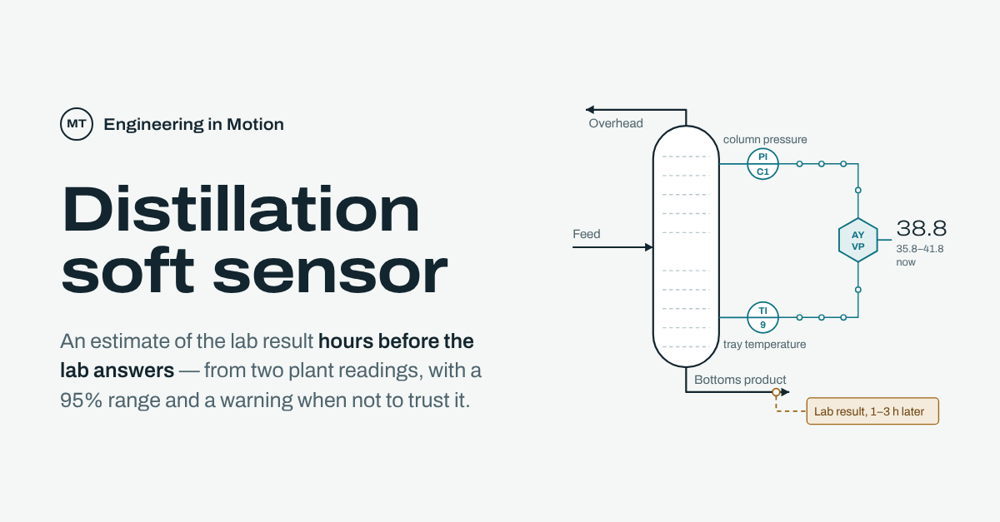

# chemai

AI for process problems, built by a chemical engineer. Each project starts from a question a plant
actually asks, lets the physics shape what the model sees, and says where its answer stops being
reliable.

**Eng. Mohammed Taleb** · [LinkedIn](https://www.linkedin.com/in/mohammed-taleb-4b4195115/) ·
[Project pages](https://engmtaleb.github.io/chemai/)

## Distillation soft sensor

[](https://engmtaleb.github.io/chemai/soft-sensor/)

The lab checks the vapour pressure of the bottoms product about once a shift, and the result comes
1–3 hours after the sample. This estimates it from two readings the plant already has — one tray
temperature and the column pressure — with a 95% range and a warning when the conditions are outside
what it was tested on.

**[Try it live](https://engmtaleb.github.io/chemai/soft-sensor/#try)** ·
[Project page](https://engmtaleb.github.io/chemai/soft-sensor/) ·
[Write-up](projects/p01_soft_sensor/README.md) ·
[Validation record](docs/VALIDATION.md) ·
[Data exploration](docs/EDA.md)

Tested on a later operating campaign that ran at less than half the reboiler duty — never a random
split:

| Measure | Result |
|---|---:|
| R² | **0.980** |
| Mean absolute error | **0.645** |
| Interval coverage (95% nominal) | 94% |
| Error on points it flags as outside the tested conditions | 7.8× the rest |

**What it found**

- **The physics changed the input, not the model.** Writing temperature as `1/T`, the form Antoine's
  equation uses, cut the error by about a third (MAE 0.953 → 0.645). A simple Ridge model then beat
  Random Forest and XGBoost, and two inputs beat all twenty-one (R² 0.980 against 0.884).
- **Pressure needs temperature.** On its own, pressure scores R² −0.50; next to temperature it is
  essential.
- **The refusal is real.** The envelope check was tested, not assumed: the points it flags have a
  7.8× larger error.
- **Its main limit:** it under-predicts high values, so it is not an off-spec alarm.

## Run it

```bash
pip install -e ".[dev]"
pytest tests -q            # 197 tests, no data needed
python -m chemai.api.run   # http://localhost:8000
```

```bash
curl -X POST localhost:8000/predict \
  -H "Content-Type: application/json" \
  -d '{"temperature": 450, "pressure": 228}'
```

```json
{"vapour_pressure": 38.8, "interval_lower": 35.84, "interval_upper": 41.75,
 "in_envelope": true, "distance": 1.26, "warning": null}
```

No endpoint returns a bare number: every answer carries its interval and the envelope check. The
deployed API is at [chemai-tr2c.onrender.com/docs](https://chemai-tr2c.onrender.com/docs) — free
hosting, so the first request after a quiet spell can take a minute.

Data is not committed. The soft sensor uses the public
[distillation-tower dataset](https://openmv.net/info/distillation-tower) from OpenMV.net.

## What's in the repository

```
chemai/        the package: physics features, models, uncertainty, envelope check, API
projects/      one folder per project: training script and write-up
docs/          validation record and data exploration
tests/         197 tests that run without any dataset
soft-sensor/   the project page, served by GitHub Pages
```

## How it is built

- **Limits are published.** Each tool states what it cannot do, next to the answer it gives.
- **Negative results are kept.** A model that lost to a simpler one is recorded with the number that
  shows it.
- **Every error found became a test.** `test_coefficient_sign_is_physical` fails if the model
  inverts against thermodynamics, `test_split_is_not_random` fails on leakage, and
  `test_rejects_celsius_temperature` catches the silent unit error.
- **A model carries its provenance.** The saved estimator records the library version that fitted
  it, and `/health` reports a mismatch.

These are deployed prototypes, not plant systems: no historian connection, no authentication, no
monitoring, no automatic retraining, no field validation.

*Implementation assisted by AI tools. The engineering framing, interpretation and validation are the
author's.*
