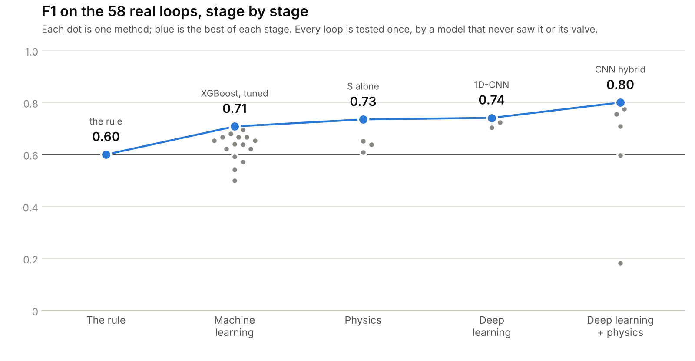
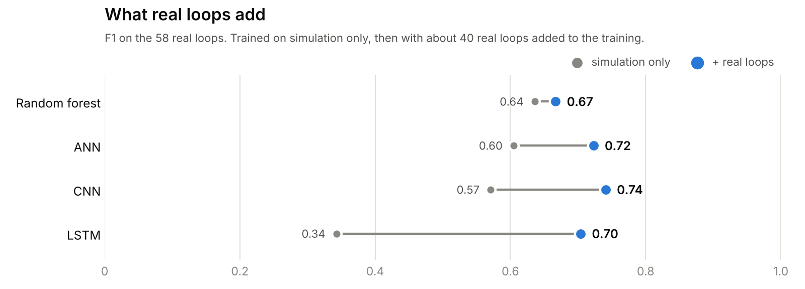

# Project 2 — Control Loop Performance

**Which ten loops do I fix this week, and who fixes them?**

A refinery runs hundreds of PID loops. A sticking valve makes one oscillate, the oscillation spreads
through the unit, and by Monday morning ten loops look faulty. Nine of them are victims. The common
repair — retuning the controller — does not fix a sticking valve: it only slows the limit cycle down,
which is how weeks get spent on a mechanical problem.

This project diagnoses loops from what a plant historian actually stores: the setpoint, the
measurement and the controller output. It answers with **the fault, the evidence, a confidence band,
the action, and the owner** — or it says the data cannot support an answer.

**Episode:** [the full walkthrough on YouTube](https://youtu.be/BzPoTwKvNgE) — the data, every
model and the results, step by step.
**Live service:** [chemai-tr2c.onrender.com/loops/](https://chemai-tr2c.onrender.com/loops/) — four
worked examples whose fault is known, or upload your own CSV.
**Validation record:** [`VALIDATION.md`](VALIDATION.md) · **Experiments:** [`experiments/`](experiments/)

*Notation:* SP the setpoint · CV the measured variable (PV in historian files) · CO the controller
output (OP) · MV the valve position, which historians rarely keep.

---

## At a glance

| Measured | Result |
|---|---:|
| Real loops from two public archives (SACAC + ISDB, duplicates removed) | **141** |
| Real loops with a stated expert label, used to test · sticky valves among them | **58** · 26 |
| Methods compared with the physics rule on those loops, each loop tested once | **29** |
| F1 on the 58 real loops: the rule → the best method (a CNN with the valve's physics) | **0.60 → 0.80** |
| Simulated plants with known faults, for training | 240 (480 runs) |
| Eastman plant-wide root cause, found among 30 loops unaided | **tag 22**, 13× the next priority |
| Cascade pairs discovered from structure alone, across 3 plants | 8 |
| Tests | 357 (whole repository) |

---

## The data — real loops first

**Real loops.** 141 loops from the SACAC PID data repository (Bauer et al., 2019) and the ISDB
benchmark (Jelali & Huang, 2010). 58 carry a stated expert label; 26 of them are sticky valves. They
hold only what a historian stores — SP, CV and CO — with no valve position and no known dead time.

**Why simulation.** 58 labelled loops are too few to train on alone. A loop simulator with known
faults — valve stiction (the two-parameter model of Choudhury et al.), tight and sluggish tuning, an
outside oscillation, a healthy loop — gives 480 runs from 240 simulated plants, where the answer is
always known.

**Cross-validation on the real loops.** The 58 loops sit in five parts; the recordings of one valve
or one plant stay in one part. Each round trains on all the simulation plus four parts — the real
loops weighted to count as much as the simulation — and tests the fifth. After five rounds **every
real loop has been tested once, by a model that never saw it or its valve.** Model settings are tuned
on the training side only (GroupKFold), so the tested part never helps choose them.

**One score, written before the run.** Sticky valves caught − false alarms. The rule scores 12 − 2 =
10; a method clearly beats it only by **more than 2**. F1 is reported beside it.

---

## Results — from a physics rule to deep learning with physics

<picture>
  <source media="(prefers-color-scheme: dark)" srcset="figures/f1_by_stage_dark.png">
  
</picture>

0. **The rule** — a regular cycle with a triangular shape is a sticky valve. 12 of 26 caught, 2 false
   alarms: **F1 0.60.**
1. **Machine learning** on four numbers per loop (Harris, regularity, shape, cycles): seven families,
   default and tuned, and two ensembles. Tuning raised F1 in five families of seven; no ensemble beat
   the best single model. Best: XGBoost, tuned — **F1 0.71.**
2. **Physics.** S, the valve's stuck band, read from the trend: after CO reverses, how far it travels
   before CV turns. S alone, with one threshold, clears the bar — **F1 0.73, +3.** Inside a forest it
   did not move the score.
3. **Deep learning.** An ANN on the numbers, and a 1D-CNN and an LSTM that read CO and CV directly.
   The networks catch the most; the CNN and the LSTM pay for it in false alarms. Best: the CNN —
   **F1 0.74.**
4. **Deep learning + physics.** *Hybrid:* the rule decides where its call is clear, the network reads
   the rest. *Rule as teacher:* the rule labels 11 unlabelled real loops it is sure about, and the
   network learns from them too. Best: the CNN hybrid — 22 of 26 caught, 7 false alarms — **F1 0.80,
   +5.**

<details open>
<summary><b>Every method, on the 58 real loops</b> (caught of 26 · false alarms · F1 · score against the rule)</summary>

| Stage | Method | Caught (of 26) | False alarms | F1 | vs the rule |
|---|---|---:|---:|---:|---:|
| The rule | Regular cycle + triangular shape | 12 | 2 | **0.60** | — |
| Machine learning | Logistic regression · default | 10 | 4 | 0.50 | −4 |
|  | Logistic regression · tuned | 14 | 5 | 0.62 | −1 |
|  | SVM · default | 12 | 4 | 0.57 | −2 |
|  | SVM · tuned | 13 | 9 | 0.54 | −6 |
|  | Decision tree · default | 15 | 6 | 0.64 | −1 |
|  | Decision tree · tuned | 16 | 7 | 0.65 | −1 |
|  | Random forest · default | 16 | 6 | 0.67 | 0 |
|  | Random forest · tuned | 17 | 9 | 0.65 | −2 |
|  | Gradient boosting · default | 13 | 5 | 0.59 | −2 |
|  | Gradient boosting · tuned | 14 | 5 | 0.62 | −1 |
|  | XGBoost · default | 17 | 7 | 0.68 | 0 |
|  | XGBoost · tuned | 17 | 5 | **0.71** | +2 |
|  | LightGBM · default | 15 | 4 | 0.67 | +1 |
|  | LightGBM · tuned | 16 | 4 | 0.70 | +2 |
|  | Ensemble · the 7 tuned vote | 16 | 6 | 0.67 | 0 |
|  | Ensemble · 5 tuned (experiment 11) | 16 | 8 | 0.64 | −2 |
| Physics | S alone · one threshold | 18 | 5 | **0.73** | **+3 ✓** |
|  | Physics forest · S added | 14 | 6 | 0.61 | −2 |
|  | Hybrid · the rule, then the physics forest | 15 | 5 | 0.65 | 0 |
|  | Rule as teacher · physics forest | 15 | 6 | 0.64 | −1 |
| Deep learning | ANN · on the numbers, S included | 17 | 4 | 0.72 | **+3 ✓** |
|  | 1D-CNN · reads CO and CV | 20 | 8 | **0.74** | +2 |
|  | LSTM · reads CO and CV | 19 | 9 | 0.70 | 0 |
| Deep learning + physics | CNN · hybrid | 22 | 7 | **0.80** | **+5 ✓** |
|  | CNN · rule as teacher | 19 | 4 | 0.78 | **+5 ✓** |
|  | LSTM · hybrid | 20 | 7 | 0.76 | **+3 ✓** |
|  | ANN · hybrid | 17 | 5 | 0.71 | +2 |
|  | ANN · rule as teacher | 14 | 7 | 0.60 | −3 |
|  | LSTM · rule as teacher | 3 | 4 | 0.18 | −11 |

*vs the rule* = (caught − false alarms) − 10; ✓ marks more than +2. F1 counts a catch for more than a
false alarm, the score counts them the same — so a higher F1 alone is not a win over a rule with only
two false alarms.

</details>

### Real data moved F1 the most

<picture>
  <source media="(prefers-color-scheme: dark)" srcset="figures/real_loops_dark.png">
  
</picture>

Trained on simulation alone, the networks caught 6 to 13 of the 26 sticky valves. With about forty
real loops in training, 17 to 20. **Real data moved F1 more than any change of model** — a larger
labelled archive is the most direct way to raise it.

### How far the numbers can be trusted

58 labelled loops is a small test. Paired 95 % ranges of the score against the rule (2000 resamples
of the loops, each method resampled together with the rule), for the five methods that clear the bar:

| Method | vs the rule | 95 % range | Resamples above 0 |
|---|---:|---:|---:|
| CNN · hybrid | +5 | −2 to +13 | 88 % |
| CNN · rule as teacher | +5 | −3 to +13 | 88 % |
| ANN · on the numbers, S included | +3 | −3 to +9 | 79 % |
| LSTM · hybrid | +3 | −4 to +10 | 76 % |
| S alone · one threshold | +3 | −4 to +10 | 74 % |

Every range still includes zero, and 29 tries on the same loops can clear a bar by luck. So the rule
stays in service, and **the CNN hybrid is the candidate to confirm on new labelled loops**, tested once
against a bar written before the run (`VALIDATION.md` §24).

---

## With the valve position logged

What turns this from a diagnosis into a maintenance tool is one more signal — MV, the stem position
the positioner already measures:

1. **Stiction becomes a measurement.** The MV-against-CO plot shows the stuck band directly, and
   buried stiction — invisible in CO and CV — is found.
2. **MV labels the data.** Physics labels thousands of real loops instead of an expert labelling 58,
   so the models train on plant data, not only on simulation.
3. **Plants that log MV teach the rest.** A model learns to read S from CO and CV where the true S is
   known, then serves the plants that do not log MV.
4. **Predictive maintenance.** Read S every month; a stuck band creeping toward the repair level is a
   valve wearing out — fix it at the next planned shutdown, before it fails.
5. **Reinforcement learning.** With the valve's state measured, an agent can learn when to repair
   which valve, or how the controller should compensate until the repair.

*Rich data means:* SP · CV · CO · MV · at least ten samples per cycle · compression that keeps the
corners · a known dead time · labels from maintenance records.

---

## ⭐ Engineering findings

### The standard index rewards the wrong thing

The Harris index is the textbook measure of loop performance. On simulated loops it rates
**tight-tuned pressure and level loops above healthy ones** (0.60–0.62 against 0.43–0.45), because
minimum-variance control *is* aggressive control. Raising the controller gain raises the index —
until the loop is one small process change away from instability. A real averaging level loop,
labelled healthy by the expert who published it, scores **0.013** — the worst possible mark for a
surge drum doing exactly its job. **So Harris ranks; it does not diagnose.**

### Half of all stiction is not in the data

Simulated sticky valves, split by how far the valve's slip jump stands above the load noise:

| Stiction | Recall |
|---|---:|
| Buried (jump below the noise) | **0.50** |
| Visible (jump above 2× the noise) | 0.83 |

Below the noise the fingerprint is not in CO or CV at all, so **no algorithm recovers it**. The fix is
not a better model — it is logging the valve position.

### Why models trained on simulation misread plant loops

**Harris is three times lower on plant data than in simulation** (0.07 against 0.22), because a plant
rarely knows its dead time and the minimum estimate must be used. A model that learned "low Harris
means sluggish tuning" called eight real sticky valves "sluggish". Hence two rules of the project:
compute every number the same way in training and in use, and never trust simulation alone.

### A closed loop hides the valve from a fit

Fitting the valve back from the data (a stiction model plus a process model) fails for a physical
reason: the controller has already put the disturbance into CO. In 30 of 48 simulated sticky runs
even the **true** valve position explains CV worse than CO does. S is therefore read from the timing
of the reversals, not fitted (`VALIDATION.md` §23).

### The historian can turn a right answer into a wrong one

Twelve known-stiction loops, compressed the way a plant historian compresses:

| Compression | Stiction found | **Read as tuning** |
|---|---:|---:|
| none | 9 | 1 |
| logged every 5 s instead of 1 s | 1 | 3 |
| deadband of 1 × std | **0** | **8** |

A slower logging rate mostly yields *undetermined* — the report admits it does not know. **A deadband
yields a confident wrong answer**, which sends the control engineer to a loop whose valve is stuck.
Corners are the stiction fingerprint, and compression rounds corners first. Working limit: **ten
samples per oscillation cycle**, and ten cycles in the record; below that the service refuses to
diagnose.

### One plant, one fault, ten victims

Thirty Eastman loops recorded together; the published root cause is tag 22, a sticking valve on a
level loop. Without being told anything, the analysis finds **eleven loops sharing one 114-minute
oscillation** and puts tag 22 first, at 13× the priority of the next loop. The weekly report then
says: *one propagation event, this is the candidate source, the other ten are probably victims — no
work orders until the source is repaired.* In a simulated plant the source and its nearest victim tie
to within 0.001, and on a second real case the ranking points at the wrong loop — a non-linear
source spreads its power into harmonics — so the source list is a candidate list for an engineer to
confirm, never a verdict.

---

## How it works

```
data quality  →  indices  →  diagnosis  →  plant view
   (week 2)     (weeks 1-2)   (weeks 2-3)   (weeks 4-5)
```

1. **Data quality first.** Five traps that have nothing to do with the valve: a frozen sensor, a loop
   in manual, a saturated valve, a quantised transmitter, a moving setpoint — plus an archive too
   coarse to carry a waveform. A frozen sensor looks like the calmest loop in the plant while the
   integral drives the process away.
2. **Indices.** Oscillation regularity (is there a cycle at all?) and the curve-fitting shape index
   (triangular, from a valve, or sinusoidal, from tuning). Loop type selects the signal: fast loops
   are read on CO, level loops on CV, because a tank integrates a square wave into a triangle.
3. **Diagnosis.** A regular oscillation with a triangular waveform is stiction; data-quality flags
   outrank the shape; everything else is *undetermined*.
4. **Plant view.** Cascade structure (a slave's setpoint *is* its master's output) and shared
   oscillation across loops recorded together.

Each step has a teaching notebook that builds it from first principles before any code enters the
package.

---

## Run it

```bash
pip install -e ".[dev,viz]"
pytest tests -q

python projects/p02_control_loops/week1.py                  # simulator · Harris study
python projects/p02_control_loops/week2_data_quality.py     # five traps, on every real loop
python projects/p02_control_loops/week2_oscillation.py      # is it oscillating at all?
python projects/p02_control_loops/week2_shape.py            # triangle or sine — the baseline
python projects/p02_control_loops/week2_classifier.py       # classifier vs baseline
python projects/p02_control_loops/week3_report.py           # the weekly report
python projects/p02_control_loops/week4_cascade.py          # cascade structure and source
python projects/p02_control_loops/week5_propagation.py      # plant-wide propagation
python projects/p02_control_loops/week6_compression.py      # what the historian throws away
python projects/p02_control_loops/compare_models.py         # five models, nested CV, on simulation
python projects/p02_control_loops/plant_check.py            # the same models on plant loops, once
python projects/p02_control_loops/week8_physics.py          # the valve's physics inside the method
# then experiments 9–12: order and extra packages in projects/p02_control_loops/experiments/README.md
python projects/p02_control_loops/figures/make_results_figures.py   # the figures and tables above
```

**Service**

```bash
python -m chemai.api.run      # http://localhost:8000/loops/
```

| Endpoint | Answers |
|---|---|
| `POST /loops/analyse/loop` | one loop: diagnosis · evidence · confidence · action · owner |
| `POST /loops/analyse/plant` | a unit: the ranked report, the propagation event, cascade candidates |
| `GET /loops/health` | the diagnoses it can make, and the limits it works under |

**Data** (not committed):

- SACAC PID data repository → `data/sacac/`
- ISDB, Jelali & Huang (2010), `isdb10.mat` → `data/isdb/`
  (`sites.ualberta.ca/~bhuang/ISDB.zip` — cite the book)

---

## ⚠️ Limits

1. **Half of buried stiction is unrecoverable** from CO and CV. Log the valve position.
2. **Ten samples per cycle and ten cycles per record**, or no diagnosis is given.
3. **58 labelled real loops** decide every comparison above; a larger labelled archive is what would
   settle them.
4. **Stiction and saturation only.** Positioner hysteresis, air-supply leaks and wrong valve sizing
   have no labelled data to test against.
5. **Cascade and propagation results are candidates**, confirmed in the field, not verdicts.
6. **Cost ranking needs the plant.** Severity is comparable only within one plant in its own units,
   and location weights (1 utility · 2 energy · 3 specification or safety) are written by an
   engineer. Without them the report ranks on diagnosis alone and says so.
7. **Cascade loops are diagnosed, not scored.** A cascade-specific Harris index is out of scope.
8. **Mixed faults blur every tool here** — stiction *and* tight tuning together reads as one or the
   other.

---

## The validation record

`VALIDATION.md` holds 24 sections written as the work happened: what was decided before seeing
results, what the data then said, and what had to change. It includes the numbers behind every claim
above, three conflicts found between published labels and the data they describe, and the measures
that were tried and rejected.

**What this is:** a deployed prototype, complete from raw data to a service anyone can call, tested
against 141 real loops with published expert labels.
**What it is not:** a plant system. No historian connection, no authentication, no field validation,
and no engineer has yet confirmed a single one of its diagnoses on a real valve.
