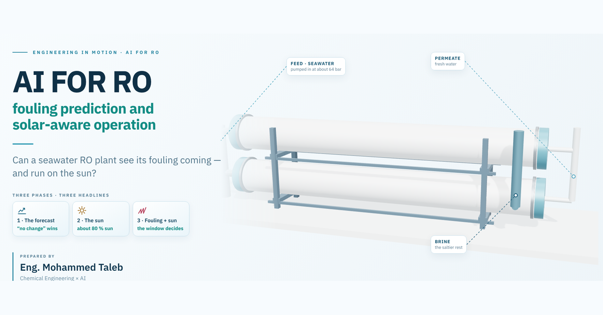
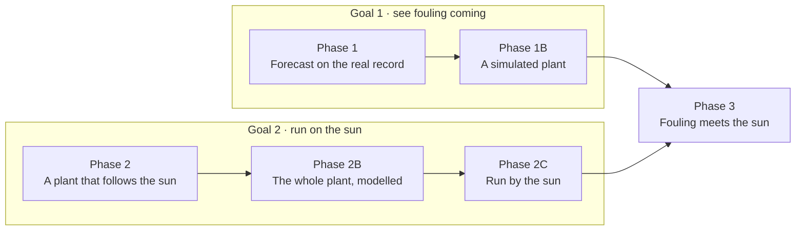
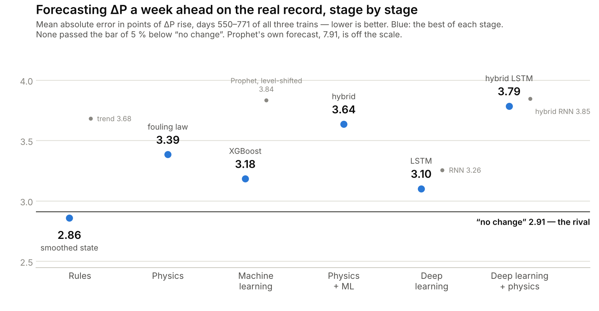
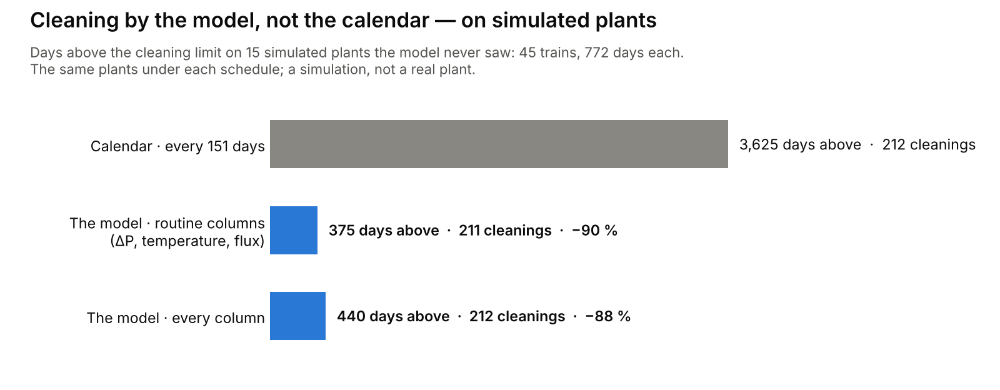
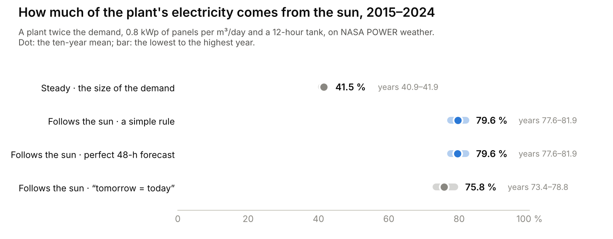
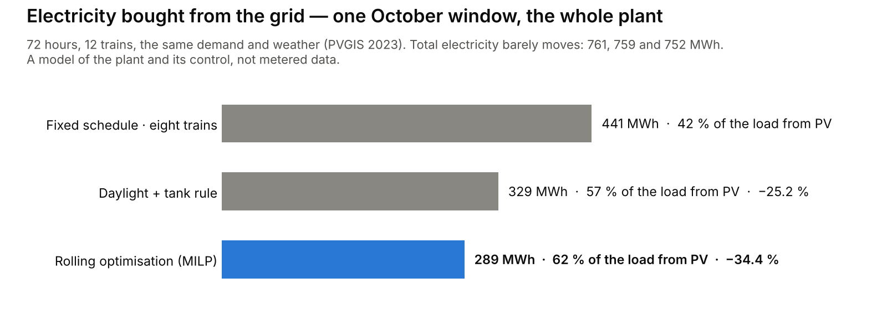
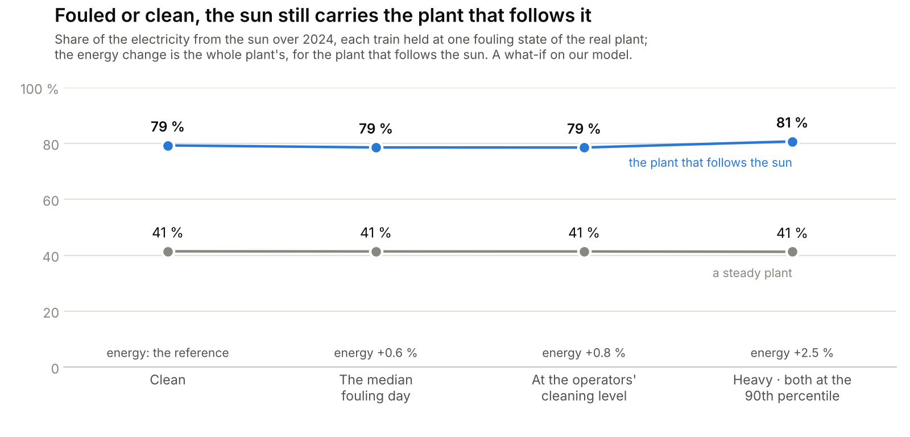

# Project 3 — AI for RO

  

  <b>One seawater RO plant, two goals: see its fouling coming, and run on the sun.</b> 
  Public data only — one real plant's published record, ten years of sun and sea, public membrane datasheets — 
  and our own models where the data stop.

  <a href="https://engmtaleb.github.io/chemai/ai-for-ro/"><b>▶&nbsp; Open the deck</b></a>
  &nbsp;&nbsp;·&nbsp;&nbsp;
  <a href="notebooks/"><b>📓&nbsp; Notebooks</b></a>
  &nbsp;&nbsp;·&nbsp;&nbsp;
  <a href="#how-it-was-tested"><b>🧪&nbsp; How it was tested</b></a>
  &nbsp;&nbsp;·&nbsp;&nbsp;
  <a href="#data-and-sources"><b>📊&nbsp; Data</b></a>

<table>
  <tr>
    <td align="center" width="25%"><h2>0 of 10</h2>forecasters beat “no change” for ΔP on the real record</td>
    <td align="center" width="25%"><h2>−90 %</h2>days above the cleaning limit, cleaning by the model simulated plants</td>
    <td align="center" width="25%"><h2>≈ 80 %</h2>of a solar plant's electricity from the sun, with a tank of water 2015–2024</td>
    <td align="center" width="25%"><h2>≈ 1 %</h2>more RO energy from fouling, on a typical day</td>
  </tr>
</table>

---

## The path

| Phase | Question | What we found |
|---|---|---|
| **1** | From a real plant's routine daily record, can any method forecast a train's ΔP 1–14 days ahead better than *no change*? | **Not on this record.** Ten forecasters, from simple rules to deep learning: none beat *no change*. The gain is in reading today well. |
| | And could a model still plan the cleanings? | **On simulated plants, yes:** about the same number of cleanings (211 against 212) and **90 %** fewer days above the limit, from the routine columns any plant logs. |
| **1B** | What would the data the record lacks let a model do? | With every column a plant logs, on simulated plants: ΔP a week ahead with an error of 2.6 points, inside its 90 % range on 90 % of new days; **88 %** fewer days above the limit. |
| **2** | How much of an RO plant's electricity can the sun cover? | **About 80 %**: a plant twice the demand, 0.8 kWp of panels per m³/day and a 12-hour tank of product water — no battery, no forecast needed. |
| **2B** | What does the physics of a whole plant say? | A 12-train plant (132,000 m³/day) at 2.88 kWh/m³; lower energy can still mean water that is too salty, so energy and quality are checked together. |
| **2C** | Does smarter control cut the grid? | An hourly re-planning optimiser (MILP) bought **34.4 %** less from the grid than a fixed schedule, for 1.2 % less total electricity. |
| **3** | What does the real plant's fouling cost, and who pays? | About **1 %** more RO energy on a typical day (3.4 % or more on the worst tenth); the solar plant still takes about 80 % from the sun. |
| Costs | When does the sun pay? | Panels pay from a grid price of **0.042 USD/kWh**. 100 % from the sun: about 1.56 USD/m³ with no grid (1.07–1.26 with the grid as backup). |

> [!NOTE]
> The schedules in phases 1 and 1B, and everything in 1B, 2B and 2C, come from models and simulated plants: they describe
> those models, not a real plant. Nothing here is operating advice for a particular plant.

---

## Phase 1 — can AI see fouling coming?

**The record.** Su, Meng & Chang (2026), *Membranes* 16(8) 257: one seawater RO plant, 3 trains, days 0–771, 18 cleanings,
and four daily indicators per train — `dp_pct` (the feed-channel ΔP's rise), `flux_pct` (the loss of 25 °C specific flux),
`sp_pct` (salt passage) and `ndp_pct` (net driving pressure). No feed quality, no temperature, no operating flux, no calendar
dates. The plant and its owner are not named by the authors, and are not named here.

**Ten forecasters**, each against the simplest rival — *a week from now, the same as today*:

<picture>
  <source media="(prefers-color-scheme: dark)" srcset="figures/phase1_forecasters_dark.png">
  
</picture>

- **ΔP: no method beat *no change*,** at 1, 3, 7 or 14 days, in either test — later days of all three trains, and a train the
  model never learnt from. None of the 64 new verdicts of the first addition (Prophet, the RNN and the LSTM) passed; as
  hybrids, the networks did worse, not better.
- **Flux: one pass** — the smoothed state 14 days ahead (+7 %).
- **State, not forecast.** The only gains came from reading today's noisy value better (the smoothed state is the median of
  the last three readings), not from predicting the change.
- **Why.** The record holds the fouling's indicators, not its causes: feed quality, temperature, operating flux.

## Phase 1B — a simulated plant, and the cleaning schedules

The causes the record lacks were made in a simulator of one RO train — fouling grows faster in warm water, at higher flux and
with worse feed; the operator cleans at a ΔP level; the sensors add noise — run on the real sea temperature (NASA POWER,
2015–2024), with the feed quality assumed and written down first.

- **A gate first.** The simulator was asked to reproduce the real plant's ΔP fingerprint (15 statistics). In two declared
  attempts no setting passed — 0 of 300, then 0 of 500 — so it is offered as a proof of concept, not as the real plant.
- **The proof of concept** (three simulated plants, one per fouling law, every column a plant logs — 25, with noise): XGBoost
  forecast ΔP a week ahead with an error of 2.6 points, inside its 90 % range on 90 % of new days.
- **The schedules.** A real plant runs once, on one schedule, so the schedules ran on 15 new simulated plants whose ΔP
  reading carries the real record's noise:

<picture>
  <source media="(prefers-color-scheme: dark)" srcset="figures/schedules_dark.png">
  
</picture>

By fouling law, with every column: linear 71 → 82 cleanings (1,360 → 270 days above), biofilm 72 → 88 (2,218 → 170), levelling
off 69 → 42 (47 → 0) — more cleanings where fouling is fast, fewer where it levels off.

## Phase 2 — a plant that follows the sun

FilmTec SW30HRLE-440 elements fitted to the public datasheet, seven per vessel; 43 g/L; design flux 14 LMH at 40 % recovery
(35 % on the hottest days); every manufacturer limit checked; isobaric energy recovery; the rest of the plant 1.23 kWh/m³; sun,
air and wind hour by hour, 2015–2024 (NASA POWER), and the daily Gulf sea temperature.

<picture>
  <source media="(prefers-color-scheme: dark)" srcset="figures/solar_share_dark.png">
  
</picture>

- **Make water while the sun shines.** The tank is the battery: 3.53 kWh/m³ against 3.54 for the steady plant, so the process
  barely notices.
- **A forecast adds nothing here.** In 2024 the simple rule bought as little grid energy as the best schedule with the whole
  year known (0.7331 against 0.7330 kWh/m³).
- **Summer narrows the window:** at 35 °C the design point breaks the lead element's limits, so the hottest days run at 35 %
  recovery. **Winter:** free condenser heat saves 0.4–0.5 %.
- **The night, as what-ifs.** On one October day, 210 MWh of noon sun went unused while 110 MWh were bought, 88 % of it at
  night; a battery of about 110 MWh and 10 MW would cover it (about 30 million USD at NREL's 2025 costs). Ten wave devices
  would add 6–16 % of the plant's power on the open Arabian Sea — under 0.5 % in the shallow northern Gulf.
- **100 % from the sun is possible**, sized for the worst winter week of ten years: about 1.56 USD/m³ of water, with no grid.

## Phase 2B — the whole plant, modelled

12 trains × 110 vessels × 7 elements (the train layout of a published large seawater plant, with our own membrane model and
flux): 132,000 m³/day gross for a demand of 88,000 (eight trains; four spare), a 44,000 m³ tank and 70,400 kWp of modelled
panels.

- At the reference point: feed 63.5 bar, product about 228 mg/L of salt, **2.88 kWh/m³** for the whole plant.
- A tighter membrane (water permeability 20 % lower, our test) needs more pressure for the same water: 63.5 → 66.1 bar.
- Salt permeability 2.5 times higher lowers the energy slightly — and puts the product above the 500 mg/L study limit. An
  optimiser must check the water, not only the energy.
- The operating window, mapped for the whole plant: 389 of 540 grid points pass every limit.

## Phase 2C — the whole plant, run by the sun

Three ways to run the same plant, with the same demand and weather (PVGIS-ERA5, four 72-hour windows of 2023): a fixed
schedule, a daylight-and-tank rule, and a rolling optimisation — mixed-integer linear programming (MILP) that re-plans every
hour which trains run and how hard, from yesterday's sun. No policy sees tomorrow's actual sun.

<picture>
  <source media="(prefers-color-scheme: dark)" srcset="figures/october_grid_dark.png">
  
</picture>

The big cut is in grid import; total electricity barely moves. In a test we set — 10 % of the water lost from day 2 — the rule
and the optimiser refilled the tank with the spare trains, while the fixed schedule ended 17,600 m³ short; with every train
already busy, the tank lost 550 m³ an hour under every policy. **More trains fix that; better control cannot.**

## Phase 3 — fouling meets the sun

Every element's feed-channel ΔP × (1 + d) and the membrane's water permeability × (1 − f), with d and f from the real plant's
indicators — a what-if, declared before the run, on phase 2's train.

<picture>
  <source media="(prefers-color-scheme: dark)" srcset="figures/fouled_year_dark.png">
  
</picture>

- **Fouling costs this train little energy:** 1.1 % more RO energy on the median train-day, 3.4 % or more on the worst tenth.
  At 25 °C a point of lost permeability costs about three times a point of ΔP rise.
- **Energy is not a reason to clean.** Project 5's rule (when to stop, in this repository's history), run with our train's
  constants, would have cleaned before the operators in at most 1–2 of 15 cycles, at one price corner only. Clean for the
  limits and the water.
- Of the four expectations written before the run, one held, two failed, and one depends on which median is meant — all
  four are reported in the notebook.

---

## What a plant should log to let AI do more

What the record behind phases 1 and 3 lacked — no promised gain, only the data every method needs:

| To log | What exactly |
|---|---|
| 🧪 **Feed quality** | SDI, turbidity and temperature, at the intake and after pretreatment |
| ⚙️ **The operating point** | flux, recovery and pressures per train; ΔP from a differential transmitter; gauges cross-checked |
| 🕒 **The raw record** | ten-minute data, with a clock you can trust |
| 🧼 **Why each cleaning** | the reason, the chemicals, the state before and after |
| ⚡ **Energy per train** | the pumps and the energy-recovery device, metered |
| ☀️ **For a solar plant** | panel output and tank level, hour by hour |

## How it was tested

- **Public data only**, each file checked against its published checksum or the SHA-256 of the copy used.
- **Written down before the run.** Phase 1, its two additions, phase 1B's gate, its proof of concept and its schedules, and
  phase 3 each have a declaration written before any result was computed (the later ones with their SHA-256 recorded); later
  changes are listed next to the originals, with their reasons.
- **Scored on data the method never saw**, in the order the days happened: phase 1 on later days (rolling origin, four
  blocks, days 550–771) and on a train it never learnt from; phase 1B's schedules on 15 new simulated plants.
- **The rival for every forecast is *no change*.** A method beats it at a horizon only if its error over the whole test is at
  least 5 % lower and lower in at least three of the four blocks.
- **A negative result is reported like a positive one** — and so is an expectation that failed.

<b>Limits</b>

1. **Phase 1:** one plant, three trains, 15 complete cleaning cycles, four daily indicators; no feed quality, no absolute
   pressures, no calendar dates.
2. **Phases 1 and 1B, the schedules:** simulated plants from one simulator family, which did not pass the real plant's
   fingerprint gate; their numbers describe that simulator, not a real plant.
3. **Phase 2:** a membrane fitted to its datasheet, NaCl osmotic pressure standing in for seawater, the rest of the plant as a
   fixed kWh/m³; sun and sea from NASA POWER, not plant meters; prices are assumptions; full availability; no dust on the
   panels; the wear of starting and stopping trains is not counted.
4. **Phases 2B and 2C:** a declared design, modelled PV (PVGIS), four 72-hour windows of one year; the MILP is mathematical
   optimisation with a time limit, not learned AI, and its solutions are not proved globally optimal; every stress is our test.
5. **Phase 3:** a what-if — the real plant's relative fouling on our train, spread evenly along the vessel (real fouling is
   not: biofouling is heavier at the feed end, scale at the brine end); one year (2024) and one design.
6. **Nothing here is operating advice** for a particular plant.

---

## What is in this folder

| Folder | What it holds | Run it |
|---|---|---|
| [`notebooks/`](notebooks/) | `ro_fouling_phase1` · `solar_ro_phase2` · `ro_link_phase3` · `ro_lab_study` (the element tests behind the hybrid example) | on Colab: [phase 1](https://colab.research.google.com/github/EngMtaleb/chemai/blob/main/projects/p03_ai_for_ro/notebooks/ro_fouling_phase1.ipynb) · [phase 2](https://colab.research.google.com/github/EngMtaleb/chemai/blob/main/projects/p03_ai_for_ro/notebooks/solar_ro_phase2.ipynb) · [phase 3](https://colab.research.google.com/github/EngMtaleb/chemai/blob/main/projects/p03_ai_for_ro/notebooks/ro_link_phase3.ipynb) · [the lab study](https://colab.research.google.com/github/EngMtaleb/chemai/blob/main/projects/p03_ai_for_ro/notebooks/ro_lab_study.ipynb) |
| [`phase1/`](phase1/) | the declaration, `prep.py` → `run.py` → `analyse.py`, saved forecasts and scores; `addition/` (Prophet, RNN, LSTM) and `addition2/` (the hybrid networks), each with its declaration, SHA-256, scripts, scores and report | `prep.py <data> <out>`, `run.py <data> <out>`, `analyse.py <out>` |
| [`phase1b/`](phase1b/) | `phase1b_declaration.md` with the simulator (`sim_v2.py`), the fingerprint and both calibration attempts; `poc/` (the proof of concept) and `schedule/` (the cleaning schedules), each declared, with scripts, logs and results | see each declaration's "how it runs" |
| [`phase2/`](phase2/) | the vessel model, the sun, the operating table, the rule, the winter cycle and the costs; `offgrid/` (100 % from the sun, the battery) | the notebook runs them |
| [`phase3/`](phase3/) | the declaration, `p4lib.py`, `run_link.py` and its results | the notebook runs them |
| [`research_package/`](research_package/) | phases 2B and 2C: the whole-plant model (`physics/`), the control study (`energy/`), the 12-train design the deck uses (`bigplant/big/`, with its changes to the package's code in `CHANGES_vs_original.diff`), and a reanalysis of the plant record (`industrial_data/`) | `python physics/run_study.py`, then `energy/run_study.py` |
| [`deck/`](deck/) | the deck's data scripts its source register names: phase 1's charts, the wave what-ifs, the plant to scale | `python make_wave_data.py` |
| [`figures/`](figures/) | the figures on this page, light and dark, drawn from the saved results above | `python make_figures.py` |

**The package.** The phases use four of chemai's modules: `chemai.data.ro_sim` (the RO plant simulator),
`chemai.data.ro_deposit` (the deposit's loader), `chemai.features.ro_physics` and `chemai.models.stopping`, with their
configuration in `chemai/config.py` and their tests in `tests/`. Phase 3's notebook installs chemai at commit `0b12b39`, where
Project 5 still is.

<b>Working names</b>

The studies were written under working names, and their declarations, scripts and printed lines keep them: phase 3 →
**phase 1**, phase 3b → **phase 1B**, phase 4 → **phase 3**, phase 1 → **the lab study**; phase 2 keeps its number. In the
logs, local folder paths were shortened; nothing else in them was changed.

## Data and sources

Data is not committed; each notebook and script downloads its own and checks it.

| Data | Source | Used in |
|---|---|---|
| One seawater RO plant's daily indicators and cleaning ledger | Su, Meng & Chang (2026), *Auditable clean-in-place decision support from routine SWRO SCADA*, *Membranes* 16(8) 257, doi:[10.3390/membranes16080257](https://doi.org/10.3390/membranes16080257); data doi:[10.5281/zenodo.21055948](https://doi.org/10.5281/zenodo.21055948) (CC BY 4.0) | 1, 1B, 3 |
| Hourly sun, air temperature and wind (29.37 N, 47.98 E); daily sea skin temperature (29.0 N, 48.75 E), 2015–2024 | [NASA POWER](https://power.larc.nasa.gov) | 1B, 2, 3 |
| Photovoltaic output, 2023 (29.3759 N, 47.9774 E; fixed 30°, south) | [JRC PVGIS 5.3](https://joint-research-centre.ec.europa.eu/photovoltaic-geographical-information-system-pvgis_en), ERA5 | 2B, 2C |
| Tests on one seawater element (SW30-4040), every 0.25 s | MHKDR submission 649 (CC BY 4.0); Sitterley, Binger & Jenne (2025), *Membranes* 15(8) 243, doi:[10.3390/membranes15080243](https://doi.org/10.3390/membranes15080243) | the lab study |
| The membrane | FilmTec™ SW30HRLE-440 product data sheet (Form No. 45-D00969-en); *Membrane System Design Guidelines for 8-inch FilmTec™ Elements* (45-D01695-en); *Design Equations and Parameters* (609-02057-604) | 2, 2B, 3 |

<b>The files the deck cites, and their SHA-256</b>

The deck's source register names the files of the research package each page rests on, with their SHA-256. Those in
`research_package/` match; the five that are public data are fetched, not committed:

| File (as the deck names it) | SHA-256 |
|---|---|
| `industrial_data/zenodo_deposit/data/derived_daily_indicator_table.csv` | `50ad81cb632dfc74e710bad70ce9bf08a014061d0ef7b602be25fc465f1f6374` |
| `industrial_data/zenodo_deposit/data/cip_campaign_ledger.csv` | `4f65351d8aaa96d8c804c63d3257978dd22628553e7ab4e12d08f1aa0a375ca7` |
| `industrial_data/zenodo_deposit/column_dictionary.md` | `c29dc5741d7c0abfae0efde047dc76e3301084b9d060b812fcf91ca2279bd333` |
| `industrial_data/zenodo_deposit/scripts/head2head.py` | `d9d719fecc8095a3b5af9192e244be434973b109a2567cedf625eece98a002bb` |
| `energy/data/pvgis_era5_kuwait_2023_original.json` | `013bb7f9c8322b553fdddb0dbb1c0f6037a14f4d7314f90554e526fa68d12ca6` |

FilmTec™ and SW30HRLE are trademarks of affiliates of DuPont de Nemours, Inc., named only to identify the public documents
the model uses; this work is not connected with or endorsed by the company. This project replaces the earlier Projects 3–5 of
this repository (RO fouling, tide and sun, when to stop); their last version stays in the repository's history, at commit
[`0b12b39`](https://github.com/EngMtaleb/chemai/tree/0b12b392e4efdbe7227d3dff201882b1a9926cd8/projects).
