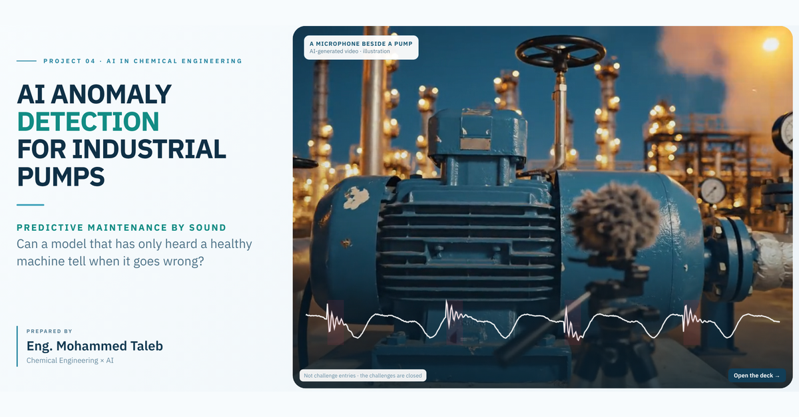
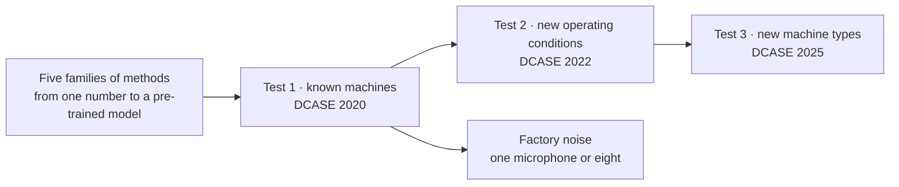
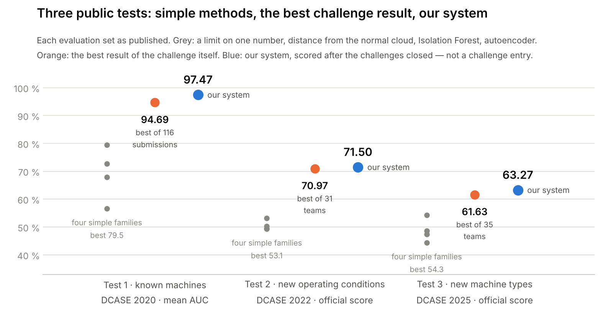
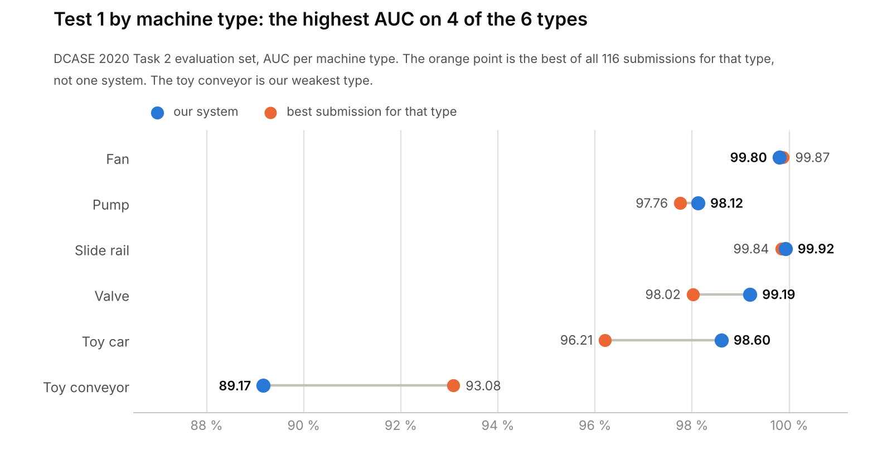
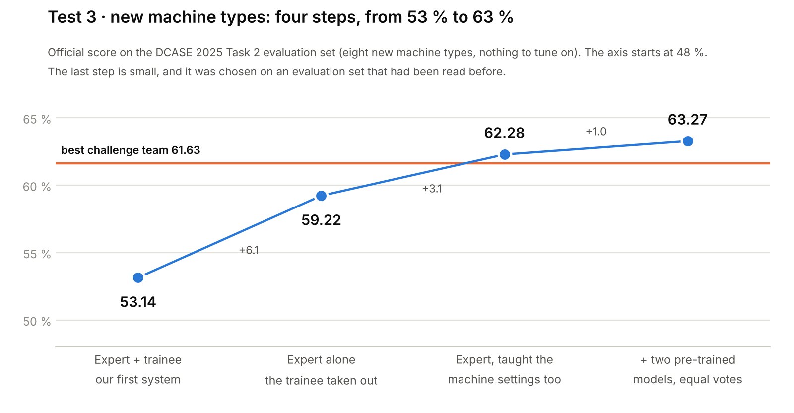
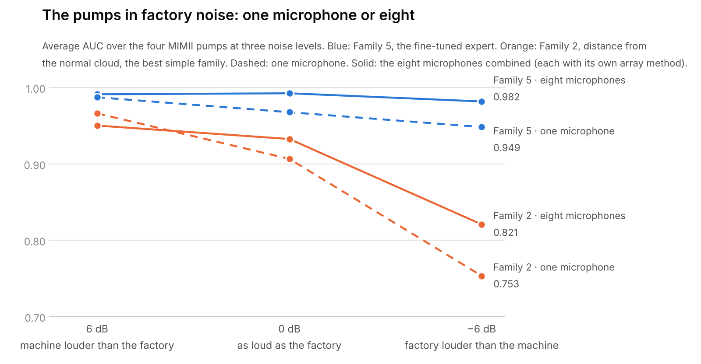

# Project 4 — Machine sound

<p align="center">
  <a href="https://engmtaleb.github.io/chemai/machine-sound/"></a>
</p>

<p align="center">
  <b>Can a model that has only heard a healthy machine tell when it goes wrong?</b><br>
  AI anomaly detection for industrial pumps, fans, valves and slide rails, from a microphone.<br>
  Public data only — MIMII, ToyADMOS and three DCASE Task 2 benchmarks.
</p>

<p align="center">
  <a href="https://engmtaleb.github.io/chemai/machine-sound/"><b>▶&nbsp; Open the deck</b></a>
  &nbsp;&nbsp;·&nbsp;&nbsp;
  <a href="#notebooks"><b>📓&nbsp; Notebooks</b></a>
  &nbsp;&nbsp;·&nbsp;&nbsp;
  <a href="https://www.kaggle.com/code/mohammedtaleb1/machine-sound-can-ai-hear-a-pump-going-wrong"><b>⚡&nbsp; Run it on Kaggle</b></a>
  &nbsp;&nbsp;·&nbsp;&nbsp;
  <a href="#how-it-was-tested"><b>🧪&nbsp; How it was tested</b></a>
  &nbsp;&nbsp;·&nbsp;&nbsp;
  <a href="#data-and-sources"><b>📊&nbsp; Data</b></a>
</p>

<table>
  <tr>
    <td align="center" width="25%"><h2>97.47 %</h2>mean AUC on known machines<br><sub>Test 1 · DCASE 2020 · best of 116 submissions: 94.69 %</sub></td>
    <td align="center" width="25%"><h2>71.50 %</h2>official score under new operating conditions<br><sub>Test 2 · DCASE 2022 · best of 31 teams: 70.97 %</sub></td>
    <td align="center" width="25%"><h2>63.27 %</h2>official score on new machine types, with nothing to tune on<br><sub>Test 3 · DCASE 2025 · best of 35 teams: 61.63 %</sub></td>
    <td align="center" width="25%"><h2>0.95 → 0.98</h2>pump AUC with the factory louder than the pump<br><sub>one microphone → eight</sub></td>
  </tr>
</table>

> [!NOTE]
> These are not challenge entries. The three challenges are closed and their evaluation labels are public. Our system was built in
> 2026 on a pre-trained audio model that the 2020 and 2022 teams did not have, and it was scored on the same evaluation sets with
> each challenge's own evaluator. Read the comparisons with that in mind, and see [the limits](#limits).

---

## The question

A pump rarely fails, so there are many hours of healthy sound and almost no recordings of a fault. The model therefore
learns the healthy sound only. Every 10-second clip gets an anomaly score: how far it is from what the model knows as healthy.

The measure is **AUC**: the chance that a faulty clip scores above a healthy one. 50 % is a coin, 100 % is perfect.

## The path



<picture>
  <source media="(prefers-color-scheme: dark)" srcset="figures/three_tests_dark.png">
  
</picture>

## Five families of methods

Each family was tried on the same recordings, from the simplest to the newest.

| Family | Four pumps, 6 dB<br><sub>average AUC</sub> | Test 1<br><sub>mean AUC, %</sub> | Test 2<br><sub>official score, %</sub> | Test 3<br><sub>official score, %</sub> |
|---|---:|---:|---:|---:|
| **1** · A limit on one number (loudness) | 0.71 | 56.61 | 49.32 | 44.37 |
| **2** · Distance from the normal cloud (128 statistics, PCA, T² + SPE) | 0.97 | 79.52 | 53.13 | 54.26 |
| **3** · Isolation Forest (the same 128 statistics) | 0.95 | 67.86 | 49.44 | 47.39 |
| **4** · Autoencoder (reconstruction error) | 0.79 | 72.70 | 50.29 | 48.68 |
| **5** · Pre-trained audio model, fine-tuned (the kept system) | 0.99 | 97.47 | 71.50 | 63.27 |

- **On the easy case the old method is nearly enough.** With the machine louder than the factory, distance from the normal cloud reaches
  0.97 on the four pumps, close to Family 5's 0.99.
- **The gap opens when the test gets harder.** On the three public tests the simple families stay between 44.37 % and
  79.52 %.

Families 1 to 4 on the three tests: notebooks 31, 32 and 33; on the four pumps: notebook 34. Family 5's row holds its best version on each
column: the expert alone on the four pumps, the fusion on Test 1, the fusion with a choice per machine type on Test 2, the expert with two
pre-trained helpers on Test 3.

## The system we kept (Family 5)

Two models listen to each clip, and their scores are added.

- **The expert.** BEATs, a model pre-trained on two million general sound clips, fine-tuned with LoRA (rank 16) on one exercise: *which
  machine is this?* A clip is scored by its distance to the nearest healthy clips of its machine. Two BEATs checkpoints, three seeds each;
  ECHO embeddings are added.
- **The trainee.** TASTgram-MFN, a small network trained from scratch on the machine's own clips with Noisy-ArcMix (Choi and Choi,
  ICASSP 2024).
- **The fusion.** Each score is divided by its spread on healthy clips held out for that purpose, and the two are added.

The words on this page and in the notebooks:

| On this page and in the deck | In the notebooks and the records |
|---|---|
| the expert | the frozen recipe (its settings were frozen, not its weights) |
| the trainee | the second view |
| our system, the fusion | the kept system, form ZP |
| the expert, taught the machine settings | attribute classes (AT) |
| official score | Ω: the harmonic mean of the AUC on the training condition, the AUC on the new condition and the pAUC |

## Three public tests

### Test 1 · known machines (DCASE 2020 Task 2)

The test clips come from the machines and the conditions the model trained on.

<picture>
  <source media="(prefers-color-scheme: dark)" srcset="figures/test1_types_dark.png">
  
</picture>

| Machine type | Our system · AUC, % | Best submission for that type · AUC, % |
|---|---:|---:|
| Fan | 99.80 | 99.87 |
| Pump | **98.12** | 97.76 |
| Slide rail | **99.92** | 99.84 |
| Valve | **99.19** | 98.02 |
| Toy car | **98.60** | 96.21 |
| Toy conveyor | 89.17 | 93.08 |
| **Mean of the six** | **97.47** | 94.69 (the best single submission) |

- The highest AUC on **4 of the 6 types**, against the best of all 116 submissions for each type.
- **The toy conveyor is the weak type:** 89.17 % against 93.08 %.
- The challenge's own baseline: 77.91 %.

Notebooks 23, 25 and 27. The table of all submissions is in [`results/external/`](results/external/).

### Test 2 · new operating conditions (DCASE 2022 Task 2)

The same machines, at a different speed, load or background noise. There are 990 healthy clips of the training condition and only 10 of
the new one, and the test does not say which condition a clip comes from.

- **The system as it is: 70.63 %.** The expert alone: 68.86 %. The trainee alone: 61.61 %.
- **Six scoring ideas that know about the two conditions: none kept.** They move the score from one condition to the other and add nothing
  (change of the official score on the development set, in points):

  | # | Idea | Change |
  |---|---|---:|
  | 1 | Scale each condition apart | +0.11 |
  | 2 | Summarise the known condition in 16 points | −0.78 |
  | 3 | Nearest clip, no scaling | −1.98 |
  | 4 | Idea 2, expert only | −1.42 |
  | 5 | Idea 3, expert only | −1.69 |
  | 6 | Idea 1, expert only | −2.42 |

- **One more idea, ours: per machine type, the fusion or the expert alone.** The scores are not touched. The development set chooses, for each
  machine type, which to use (the trainee alone was a candidate too, and was chosen for no type): the expert alone for ToyCar, gearbox and valve, the fusion for the rest
  (+0.76 points on the development set).
- **With that choice: 71.50 %.** The best of the challenge's 31 teams: 70.97 %.

Notebooks 28 and 29, and `scripts/per_type_choice_2022.py`.

### Test 3 · new machine types (DCASE 2025 Task 2)

Eight machine types that share nothing with the machines used for development. Each comes with healthy clips only, and there is nothing to tune on.

<picture>
  <source media="(prefers-color-scheme: dark)" srcset="figures/test3_steps_dark.png">
  
</picture>

| Step | What changed | Official score, % |
|---|---|---:|
| 1 | The system as it is: expert + trainee | 53.14 |
| 2 | The trainee taken out | 59.22 |
| 3 | The expert's exercise changed: *which machine, and at which setting?* (speed, load…) | 62.28 |
| 4 | Two pre-trained models added without training; 33 ways of listening, equal votes | **63.27** |
| | The best of the challenge's 35 teams | 61.63 |

What did not help:

- **Two experts together** (steps 2 and 3 added): 61.44 %, below step 3 alone.
- **A fusion that weights its own listeners** (our idea): 62.71 %, below equal votes.
- **A published training-free recipe on our files:** 59.23 %. Its paper reports
  62.4 % (arXiv 2603.04605); this work does not explain the gap.
- **The target was not reached:** 63.95 % is published (arXiv 2609.27362).

Notebooks 30 and 35, `scripts/two_experts_2025.py` and `scripts/analyse_n35.py`.

## Factory noise, and eight microphones

MIMII was recorded with a ring of eight microphones at three noise levels. Every published result on it that we found listens with one.

<picture>
  <source media="(prefers-color-scheme: dark)" srcset="figures/noise_array_dark.png">
  
</picture>

The expert at −6 dB, the factory louder than the machine (average AUC over four machines of a type):

| Machine type | One microphone | Eight microphones |
|---|---:|---:|
| Pump | 0.949 | 0.982 |
| Fan | 0.891 | 0.993 |
| Valve | 0.983 | 0.974 |
| Slide rail | 0.971 | 0.997 |

- **The array helps most where one microphone is weakest:** the fan goes from 0.891 to 0.993, the pump from
  0.949 to 0.982.
- **It is not free everywhere:** the valve is slightly lower with eight (0.974 against 0.983).
- **The simple families gain too, and stay far behind:** distance from the normal cloud on the pumps at −6 dB goes from
  0.753 to 0.821 with delay-and-sum beamforming.
- One microphone remains the practical choice in a plant: simple, low-cost, realistic. The array is what to reach for when the noise wins.

Notebooks 11, 23 and 34.

## What a plant should record to use this

This project did not test a plant, and nothing here promises a gain. It is only what any method of this kind needs:

| To record | What exactly |
|---|---|
| 🎙️ **A healthy period** | sound (or vibration) after maintenance, with no open work orders: this is the training data |
| ⚙️ **The operating condition, with every recording** | speed and load: the cheapest thing to add, and the most useful |
| 🛠️ **Maintenance work orders** | what broke, and when: the answers a system is graded with |
| 🔁 **A new baseline after maintenance** | a repaired or a new machine has a new “normal” |

The order matters more than the model: start with the simplest method (a limit, then distance), move to a network only if it beats
them, and judge with real faults and false alarms.

## How it was tested

- **The rules came first.** Each notebook has a rules file written before it ran: the question, the fixed settings and the bar a result must
  pass. They are in [`records/`](records/), named `RULES_…_written_before_running.md`.
- **The official evaluators.** Each challenge's own evaluator scored the evaluation sets, at a pinned commit. For the system as it is, the
  score files were written and locked before the labels were read.
- **Tested before it ran.** Notebooks 25 to 30, 34 and 35 were each run end to end on synthetic clips before they saw real data
  (`records/N…_tests_before_delivery_….md`).
- **Checked again from the saved files.** For notebooks 25 to 30 an independent script recomputed the results from the per-clip scores
  (`records/N…_checks_….log`).
- **Negative results are kept,** each with the number that shows it.

## Limits

- **Not challenge entries.** The challenges are closed, the labels are public, and the systems here use pre-trained models that the 2020
  and 2022 teams did not have.
- **Test 1 is compared by mean AUC.** The challenge ranked by the average rank over AUC and pAUC, machine by machine; the submission with
  the best mean AUC is officially ranked 8. The table of 116
  submissions was transcribed from the challenge's results page, and only five of its rows were checked against a second source.
  The four MIMII types' evaluation set was scored twice: by the expert alone (notebook 23), then by the fusion (notebook 25), kept by a rule
  written before it ran. The two toy types were scored once.
- **Test 2: the per-type choice came after the first scoring.** The system as it is (70.63 %) is the result of the rules written
  first. The choice that gives 71.50 % used development clips only, but it was made after the evaluation result had been seen. Its
  0.53 points over the first team are inside the noise of this test: in notebook 28's resampling the system as it is came first in
  733 of 2,000 draws.
- **Test 3: the last step is small and was chosen late.** 63.27 % is 0.99 points above 62.28 %, under the 1-point bar our own rules
  use for a clear difference, and it is one of six readings compared on an evaluation set that had been read before. By the rule written before
  notebook 30 ran, the "machine settings" exercise was not adopted either: in the fusion its gain on the development set was
  0.75 points, under the same bar, and for the expert alone the development score went down
  (56.85 → 55.28 %) while the evaluation score went up. On this test the development set does not predict the
  evaluation set.
- **The autoencoder family depends on the library version** in notebook 34 (two pumps moved by +0.03 and −0.05), so its small differences
  are not read as effects.
- **Recordings, not a plant.** Clips of 10 seconds from laboratory and toy machines, with faults made on purpose and factory noise mixed in.
  This is a teaching project, not a machine-protection system, and it says nothing about a particular plant.

## Notebooks

All run on Google Colab: Runtime › Run all. Each downloads its data from Zenodo and checks every file against its published MD5; if Colab
disconnects, running it again continues from the last save. Notebook 1 must run first: it puts the pre-trained model in Google Drive.

| Notebook | What it does | Needs first |
|---|---|---|
| [1 · setup](notebooks/P04_MIMII_BEATs_Embeddings_Colab.ipynb) · [Colab](https://colab.research.google.com/github/EngMtaleb/chemai/blob/main/projects/p04_machine_sound/notebooks/P04_MIMII_BEATs_Embeddings_Colab.ipynb) | Downloads the pre-trained model (BEATs iter3+) to Drive; first embeddings of the MIMII pumps | — |
| [11 · array](notebooks/P04_N11_MIMII_Array_Physics_Noise_Colab.ipynb) · [Colab](https://colab.research.google.com/github/EngMtaleb/chemai/blob/main/projects/p04_machine_sound/notebooks/P04_N11_MIMII_Array_Physics_Noise_Colab.ipynb) | Factory noise and the eight microphones, with the pre-trained model as it is | 1 |
| [23 · expert](notebooks/P04_N23_MIMII_External_Judgement_Colab.ipynb) · [Colab](https://colab.research.google.com/github/EngMtaleb/chemai/blob/main/projects/p04_machine_sound/notebooks/P04_N23_MIMII_External_Judgement_Colab.ipynb) | The fine-tuned expert at 6, 0 and −6 dB, one microphone and eight; first scoring on DCASE 2020 | 1, and 15–22b below |
| [25 · trainee](notebooks/P04_N25_Second_View_DCASE2020_Colab.ipynb) · [Colab](https://colab.research.google.com/github/EngMtaleb/chemai/blob/main/projects/p04_machine_sound/notebooks/P04_N25_Second_View_DCASE2020_Colab.ipynb) | The trainee and the fusion on DCASE 2020 (fan, pump, slide rail, valve) | 23 |
| [26 · noise](notebooks/P04_N26_Second_View_MIMII_Levels_Colab.ipynb) · [Colab](https://colab.research.google.com/github/EngMtaleb/chemai/blob/main/projects/p04_machine_sound/notebooks/P04_N26_Second_View_MIMII_Levels_Colab.ipynb) | The fusion at MIMII's three noise levels | 20, 21, 22b, 23 |
| [27 · Test 1](notebooks/P04_N27_Toy_Types_Colab.ipynb) · [Colab](https://colab.research.google.com/github/EngMtaleb/chemai/blob/main/projects/p04_machine_sound/notebooks/P04_N27_Toy_Types_Colab.ipynb) | The toy car and the toy conveyor: Test 1 complete | 1 |
| [28 · Test 2](notebooks/P04_N28_Domain_Shift_DCASE2022_Colab.ipynb) · [Colab](https://colab.research.google.com/github/EngMtaleb/chemai/blob/main/projects/p04_machine_sound/notebooks/P04_N28_Domain_Shift_DCASE2022_Colab.ipynb) | The system as it is on DCASE 2022 | 1 |
| [29 · six ideas](notebooks/P04_N29_Domain_Backends_DCASE2022_Colab.ipynb) · [Colab](https://colab.research.google.com/github/EngMtaleb/chemai/blob/main/projects/p04_machine_sound/notebooks/P04_N29_Domain_Backends_DCASE2022_Colab.ipynb) | Six scorings that know the two conditions (no training) | 28 |
| [30 · Test 3](notebooks/P04_N30_First_Shot_DCASE2025_Colab.ipynb) · [Colab](https://colab.research.google.com/github/EngMtaleb/chemai/blob/main/projects/p04_machine_sound/notebooks/P04_N30_First_Shot_DCASE2025_Colab.ipynb) | The system on DCASE 2025, as it is and with the machine settings as classes | 1 |
| [31](notebooks/P04_N31_Simple_Families_DCASE2020_Colab.ipynb) · [Colab](https://colab.research.google.com/github/EngMtaleb/chemai/blob/main/projects/p04_machine_sound/notebooks/P04_N31_Simple_Families_DCASE2020_Colab.ipynb) · [32](notebooks/P04_N32_Simple_Families_DCASE2022_Colab.ipynb) · [Colab](https://colab.research.google.com/github/EngMtaleb/chemai/blob/main/projects/p04_machine_sound/notebooks/P04_N32_Simple_Families_DCASE2022_Colab.ipynb) · [33](notebooks/P04_N33_Simple_Families_DCASE2025_Colab.ipynb) · [Colab](https://colab.research.google.com/github/EngMtaleb/chemai/blob/main/projects/p04_machine_sound/notebooks/P04_N33_Simple_Families_DCASE2025_Colab.ipynb) | The four simple families on the three tests (CPU only) | — |
| [34 · array](notebooks/P04_N34_Array_Simple_Families_Colab.ipynb) · [Colab](https://colab.research.google.com/github/EngMtaleb/chemai/blob/main/projects/p04_machine_sound/notebooks/P04_N34_Array_Simple_Families_Colab.ipynb) | The eight microphones with the four simple families (CPU only) | — |
| [35 · Test 3](notebooks/P04_N35_Pooling_First_Shot_DCASE2025_Colab.ipynb) · [Colab](https://colab.research.google.com/github/EngMtaleb/chemai/blob/main/projects/p04_machine_sound/notebooks/P04_N35_Pooling_First_Shot_DCASE2025_Colab.ipynb) | Test 3: other ways of pooling, two pre-trained helpers, the 33 listeners | 1, 30 |

**No GPU, a few seconds:** [`P04_Machine_Sound_Three_Tests_Kaggle.ipynb`](notebooks/P04_Machine_Sound_Three_Tests_Kaggle.ipynb) trains nothing. It reads
the scores our system gave to every test clip and recomputes the three tests, with a table and a chart for each. It is written for Kaggle:
[the notebook, with its results](https://www.kaggle.com/code/mohammedtaleb1/machine-sound-can-ai-hear-a-pump-going-wrong) and [the dataset of per-clip scores](https://www.kaggle.com/datasets/mohammedtaleb1/machine-sound-anomaly-detection-saved-scores).
It downloads the labels from the organisers when it runs; where a publisher does not serve the file, it shows the recorded numbers and says so.

[`notebooks/development/`](notebooks/development/) holds notebooks 15, 19, 20, 21, 22 and 22b: the steps that fixed the expert's recipe.
They run in that order, after notebooks 1 and 11, and notebooks 23 and 26 read the folders they leave in Drive. The earlier notebooks of the
project are not published here.

**Run times we measured:** notebook 28 took 4.3 hours and notebooks 25 and 26 about 2 hours each on an RTX PRO 6000; notebook 35 took
1.3 hours on a T4; notebook 29 took 13 minutes. The autoencoders of notebooks 31 to 34 are slow on CPU: between 2 and 6.5 hours per notebook.

## What is in this folder

```
notebooks/   the Colab notebooks, without outputs
records/     for each notebook: the rules written before it ran, and what it returned
results/     each notebook's summary file, as it came back; summary.json holds the numbers quoted on this page
scripts/     three readings made from saved scores (per-type choice, two experts, notebook 35) and the reading of notebook 34
figures/     the figures of this page and the script that draws them from results/summary.json
```

- The per-clip score files are not in the repository. Each notebook writes them to its results zip; the scripts read them from that zip,
  unpacked into the notebook's folder under `results/` (for example `results/run_2026-11-13_n28/`). The scores of the three tests are
  also published as [a Kaggle dataset](https://www.kaggle.com/datasets/mohammedtaleb1/machine-sound-anomaly-detection-saved-scores).
- Inside the notebooks and the records, the rules are named `results/mimii_beats/RULES_…`; here they are in `records/`.
- The records are working documents, kept as they were written. Where one says "the user", it means the author.

## Data and sources

No recording is in this repository. The notebooks download each file from its publisher.

| Data | Where | Licence |
|---|---|---|
| MIMII (Purohit et al., 2019) — all eight microphones, three noise levels | [Zenodo 3384388](https://zenodo.org/records/3384388) | CC BY-SA 4.0 |
| DCASE 2020 Task 2 — development, additional training and evaluation sets (MIMII and ToyADMOS) | Zenodo [3678171](https://zenodo.org/records/3678171) · [3727685](https://zenodo.org/records/3727685) · [3841772](https://zenodo.org/records/3841772) · [3951620](https://zenodo.org/records/3951620) | CC BY-NC-SA 4.0, as read on the development and additional-training records |
| DCASE 2022 Task 2 (MIMII DG and ToyADMOS2) | Zenodo [6355122](https://zenodo.org/records/6355122) · [6462969](https://zenodo.org/records/6462969) · [6586456](https://zenodo.org/records/6586456) | as stated on each record |
| DCASE 2025 Task 2 | Zenodo [15097779](https://zenodo.org/records/15097779) · [15392814](https://zenodo.org/records/15392814) · [15519362](https://zenodo.org/records/15519362) | CC BY 4.0 |

| Model or code | Where | Licence |
|---|---|---|
| BEATs iter3+ and iter3 (Chen et al., 2022) | [microsoft/unilm · beats](https://github.com/microsoft/unilm/tree/master/beats) | MIT |
| ECHO | [yucongzh/echo-small-0824](https://huggingface.co/yucongzh/echo-small-0824) on Hugging Face | as on its model card |
| TASTgram-MFN with Noisy-ArcMix (Choi and Choi, ICASSP 2024, arXiv 2310.06364) | [soonhyeon/Noisy-ArcMix](https://github.com/soonhyeon/Noisy-ArcMix) | MIT |
| The official evaluators | [2020](https://github.com/y-kawagu/dcase2020_task2_evaluator) · [2022](https://github.com/Kota-Dohi/dcase2022_evaluator) · [2025](https://github.com/nttcslab/dcase2025_task2_evaluator) | each repository's own |

The deck plays eight short clips of the DCASE 2020 development set (MIMII machines), credited on their page under that set's licence.

*Implementation assisted by AI tools. The engineering framing, interpretation and validation are the author's.*
