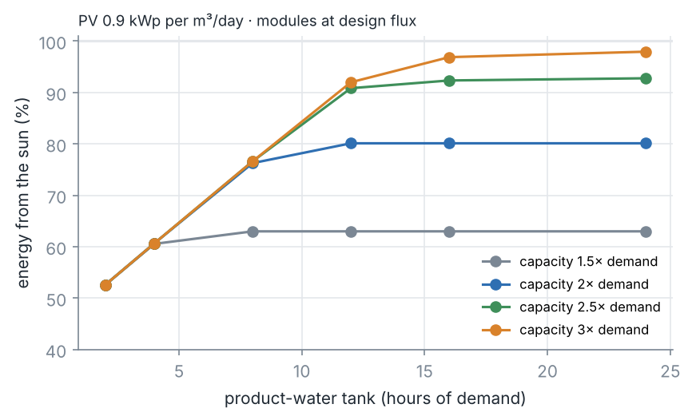
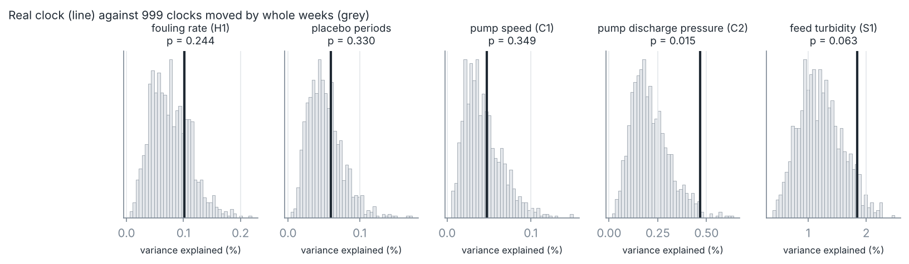

# Project 4 — The moon, the sun and a seawater membrane

**Live:** [chemai-tr2c.onrender.com/sun/](https://chemai-tr2c.onrender.com/sun/) — the results, a
design explorer for solar and tidal supply, and the declared tide (or time-of-day) test run on your
own `t,value` CSV.

**The record clears solar operation.** Over 5,106 hours of a seawater
ultrafiltration pilot, the fouling rate does not depend on the hour of the day
(daylight hours within −2.5 % to +1.2 % of the rest) or on a daily stop and
restart (first 3 hours within −3.9 % to +10.0 %). A solar-run pre-treatment can
produce in daylight and stop at night, at its usual flux, without fouling
faster. Both tests were declared before they were run, with positive controls,
placebos and power analyses.

**What it takes to run on the sun.** With modules switched on and off at their
usual flux — so the record's no-penalty result applies — a synthetic sunny year
needs, per m³/day of water: 3× production capacity, a 16-hour tank and 0.7 kWp
of PV for 93 % solar energy (grid electricity 3.26 → 0.23 kWh/m³). A simple
rule with no forecast does as well as a perfect-foresight plan once the tank is
that big. Getting the capacity by pushing flux instead of adding modules would
raise fouling per m³ — the design study is in VALIDATION.md 8. Where a strong
tidal current exists, a turbine supplying about a quarter of the energy lets
the plant reach 90 % renewable with 2× capacity and an 8-hour tank
(VALIDATION.md 9): the moon does not foul the membrane, but it can run it at
night.



**And the moon does not matter here.** The first question was the tide:
not at this intake, and not by more than about 10 % of the fouling rate. A test
declared before it was run found no tide-locked component in the fouling of
the pilot over 2012–2015 (p = 0.24), with
the power to find one whose swing is 10 % of the median rate (found in 99.5 %
of simulated trials). Calibration held; the out-of-time confirmation failed.
The pilot's pump hydraulics carry a faint, steady tidal signature (exploratory),
so the feed did feel the tide — the fouling did not follow it.

| | result |
|---|---|
| Fouling rate locked to the tide (declared, H1) | **no** — p = 0.244, needed ≤ 0.01 |
| What it could have missed | a swing of 5 % of the median rate could slip through (found 43 % of the time); 10 % could not (99.5 %) |
| Same test on made-up periods (calibration) | p = 0.330 — the test does not invent signals |
| Fit 2012–13, freeze, score 2014–15 | explains −1.3 % (worse than nothing), p = 0.248 |
| Pump hydraulics (declared controls) | p = 0.349 and 0.015 — not passed |
| Pump hydraulics, per-episode phase check (exploratory) | M2-locked, opposite phases for speed and pressure, stable across both halves |
| Feed turbidity, 2013 only | p = 0.063 — undecided |
| **Fouling follows the hour of the day** (declared, H2) | **no** — p = 0.746; daylight hours −0.8 % (−2.5 % to +1.2 %) |
| Temperature follows the hour (positive control) | yes — p = 0.001, the clock and the test work |
| **First 3 h after a restart foul differently** (declared, H3) | **no** — p = 0.382; +3.1 % (−3.9 % to +10.0 %) |
| Pretend restart 24 h in (placebo) | p = 0.842 |



## Why the question was worth asking

Seawater plants draw from the sea, and the sea follows the moon. If the fouling
load at an intake rose and fell with the tide, part of the plant's future
fouling would be known years ahead — something no sensor and no forecast model
can give — and backwash, coagulant and production could be planned against it.
At this pilot the answer is no, and the method that gave it can be pointed at
any plant log with a clock.

## How the test cannot be fooled by the day

A process can swing every ~12 hours for many reasons: shifts, sunlight,
temperature, a controller. Only the tide keeps the same phase against the
astronomical clock across runs months and years apart. So the test fits the
tidal constituents (M2, N2, O1, M4 — periods from astronomy; no tide gauge, no
location) and compares the real clock with 999 clocks moved by whole weeks:
whole weeks keep time of day and day of week, and scramble only the moon. The
data are never moved. Unit tests check that it finds a true tide, ignores a
12.42 h wave whose phase changes between episodes, ignores a 12 h clock wave,
and stays calibrated on noise (`tests/test_tide_test.py`).

## Data

Public UF pilot record, Zenodo 4630769 (CC0), also Dryad
[doi:10.5068/D1310B](https://doi.org/10.5068/D1310B): an ultrafiltration unit
pre-treating seawater for a reverse-osmosis pilot. The site is not named here.
After the audit (VALIDATION.md 1): 107 runs with a trusted clock, 5,106 h, cut
into 14,998 filtration segments. The audit also found that the depositors'
`test/` folder is not separated in time from `training/`: three test files
continue a training run without a break.

## What this is not

One pilot. Its hydraulics suggest the feed came through storage that damps the
tide; an intake that draws straight from the sea could behave differently, and
this test is how to find out. The fouling rate is relative (%/h) — membrane
area is not in the record. Turbidity covers 2013 only.

## Files

| | |
|---|---|
| [DECLARED_BEFORE_RUN.md](DECLARED_BEFORE_RUN.md) | the tide test, fixed before it ran (commit `1989858`) |
| [DECLARED_BEFORE_RUN_2.md](DECLARED_BEFORE_RUN_2.md) | the sun tests, fixed before they ran (commit `6d3dd6e`) |
| [VALIDATION.md](VALIDATION.md) | every number, with its source |
| `step1_audit.py` … `step4_tide_test.py` | the tide: audit, segments, power, test |
| `step5_sun_power.py`, `step6_sun_tests.py` | the sun: power, then the daylight and restart tests |
| `step7a_uf_energy.py` | what the UF pre-treatment costs in energy, from the record |
| `step7_solar_plan.py`, `step8_sun_and_moon.py` | the design study: PV, tank, capacity, then a tidal turbine |
| `make_figures.py`, `make_sun_designs.py` | the figures, and the design table the service reads |
| `results/` | audit, segments (1.9 MB parquet), power, tests, designs |
| `chemai/data/uf_pilot.py`, `chemai/features/uf_segments.py` | reading the record, cutting the segments |
| `chemai/evaluation/tide_test.py`, `chemai/evaluation/restart_test.py`, `chemai/models/solar_plan.py` | the tests and the plan |
| `chemai/api/sun_app.py` | the service at `/sun` (VALIDATION.md 10) |
| `notebooks/` | five Colab notebooks that run from the committed segments |

## Notebooks

The same steps cell by cell, runnable in Google Colab with nothing installed. They read
the committed tables, so nothing needs downloading.

| | |
|---|---|
| [01 · Read the record before testing it](notebooks/01_the_record.ipynb) | [](https://colab.research.google.com/github/EngMtaleb/chemai/blob/main/projects/p04_tide_fouling/notebooks/01_the_record.ipynb) |
| [02 · From pressure tags to a fouling rate](notebooks/02_from_tags_to_fouling.ipynb) | [](https://colab.research.google.com/github/EngMtaleb/chemai/blob/main/projects/p04_tide_fouling/notebooks/02_from_tags_to_fouling.ipynb) |
| [03 · Is the fouling locked to the moon?](notebooks/03_the_tide_test.ipynb) | [](https://colab.research.google.com/github/EngMtaleb/chemai/blob/main/projects/p04_tide_fouling/notebooks/03_the_tide_test.ipynb) |
| [04 · Does the membrane mind the sun?](notebooks/04_the_sun_tests.ipynb) | [](https://colab.research.google.com/github/EngMtaleb/chemai/blob/main/projects/p04_tide_fouling/notebooks/04_the_sun_tests.ipynb) |
| [05 · Running on the sun — and the moon](notebooks/05_sun_and_moon_design.ipynb) | [](https://colab.research.google.com/github/EngMtaleb/chemai/blob/main/projects/p04_tide_fouling/notebooks/05_sun_and_moon_design.ipynb) |

## Run it

```bash
pip install -e ".[viz,data]"
python -c "from chemai.data.uf_pilot import download_archive, extract_archive; extract_archive(download_archive())"
python projects/p04_tide_fouling/step1_audit.py
python projects/p04_tide_fouling/step2_segments.py
python projects/p04_tide_fouling/step3_power.py
python projects/p04_tide_fouling/step4_tide_test.py
python projects/p04_tide_fouling/step5_sun_power.py
python projects/p04_tide_fouling/step6_sun_tests.py
python projects/p04_tide_fouling/step7a_uf_energy.py      # needs the archive
python projects/p04_tide_fouling/step7_solar_plan.py
python projects/p04_tide_fouling/step8_sun_and_moon.py
python projects/p04_tide_fouling/make_figures.py
```

`results/segments.parquet` is committed, so steps 3–8 (all but 7a) run without
the 356 MB archive (steps 5–6 also read `results/episodes.parquet`, also
committed).

Test a log of your own without the service:

```python
import pandas as pd
from chemai.evaluation.tide_test import series_test
log = pd.read_csv("my_log.csv", parse_dates=["t"])      # columns t, value[, run]
print(series_test(log, kind="tide"))                    # or kind="clock"
```
