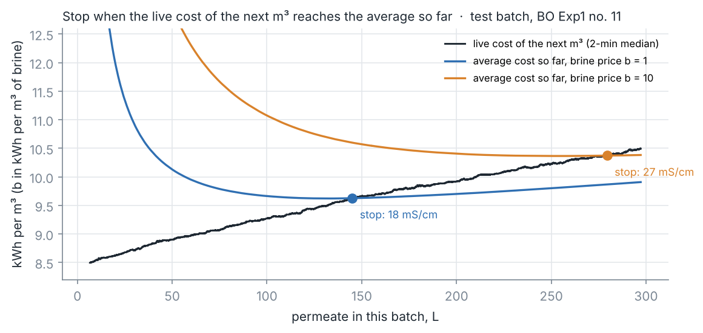
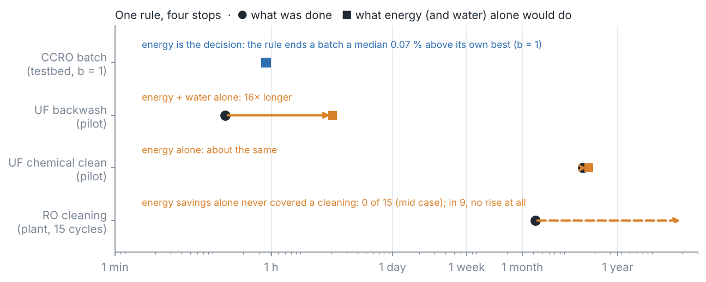
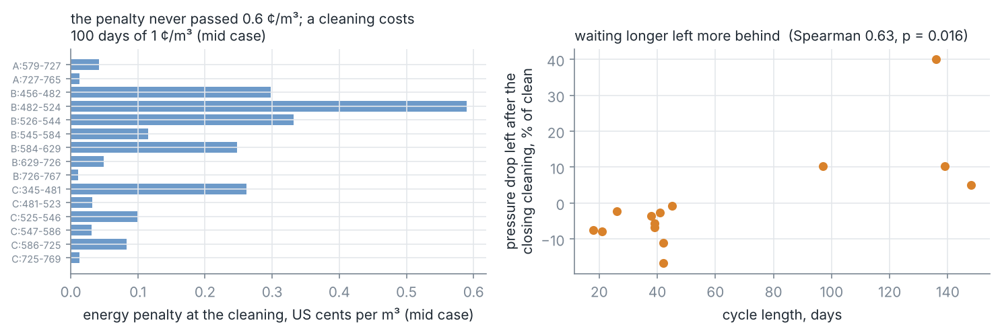
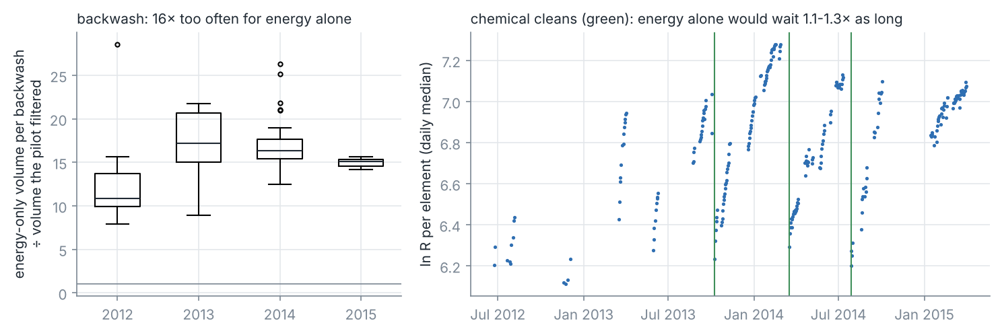

# Project 5 — When to Stop

**One rule for four decisions in a desalination plant: when to end a reverse-osmosis batch, when to
backwash a filter, when to clean it chemically, and when to clean an RO train.**

**Live:** [chemai-tr2c.onrender.com/stop/](https://chemai-tr2c.onrender.com/stop/) — the rule on a
real batch or on your own log, and the square-root law for cleaning intervals.

Every cycle in a desalination plant gets dearer the longer it runs: a closed loop concentrates, a
membrane fouls. Ending it has a fixed price — a drain and its brine, a backwash, a chemical clean.
Per cubic metre over the whole cycle, the cost is lowest where

> **the live cost of the next cubic metre equals the average cost of the cycle so far.**

That is the whole rule. It needs no model — only the live cost the plant already logs and the price
of the last stop. When the live cost climbs in a straight line it has a closed form, the square-root
law of cleaning intervals: **T\* = √(2 × fixed cost ÷ climb rate)** — a stop twice as costly to make
should come √2 times later, not twice.



---

## ⭐ The headline: tested once, on batches it had never seen

A public closed-circuit RO testbed (doi:10.7481/1963162) ran two published optimisers on the same
question — when to end each batch, trading energy against brine. The rule was developed on one
optimiser's batches (extremum seeking, June–July 2021), frozen in a declaration committed to this
repository, and scored once on the other's (Bayesian optimisation, October 2021):

| 153 held-out batches | brine price b = 1 | b = 10 |
|---|---:|---:|
| **The rule's end, above the batch's own best** — median | **0.069 %** | **0.019 %** |
| 90th percentile | 0.112 % | 0.061 % |
| Declared limit (median · p90) | 0.5 % · 1.0 % | 0.5 % · 1.0 % |
| The optimiser's own end, above the best — median, where measurable | 0.52 % | 0.06 % |
| Batches the optimiser ended while the cost was still falling | 69 % | 95–100 % |

The extremum-seeking controller ended **all 580** of its development batches while the cost was still
falling. Both optimisers needed tens to hundreds of batches to search; the rule reads each batch's
own signal and needs none. The differences in cost are small because near its best a batch's cost is
flat — which is also why a slow search across batches gains so little.

**What failed.** The square-root law, used as an early *forecast* of the stop (fitted on minutes
5–20), landed within 4–7 % for b ≤ 3 but **11 % short at b = 10**, past the declared 10 %. The live
cost bends slightly; the further out the stop, the more the early slope misleads. The online rule
needs no straight line and was unaffected.

---

## What the same rule says at four time scales



| Decision | Every | Is energy the reason to stop? | Evidence |
|---|---|---|---|
| End a closed-circuit RO batch | ~1 hour | **Yes** | the rule above: 0.02–0.07 % from the best, 153 held-out batches |
| Backwash a UF element | ~20 minutes | **No** | energy and water alone: ~16× fewer backwashes (declared ≥ 5×: passed) |
| Clean a UF membrane chemically | ~4–5 months | **About** | energy alone: 1.1–1.3× the intervals actually run (2 intervals) |
| Clean an RO train | weeks–months | **No** | energy never paid for a cleaning: 0 of 15 cycles (declared ≤ 4: passed) |

### RO cleaning: energy is the smallest reason

On the seawater plant deposit of Project 3 (15 complete cleaning cycles), the extra energy a fouled
train spends to hold its production never reached the average cost of a cleaning before the
operators cleaned — not once in the mid case, and not once in 156 of the 216 price-and-plant cases
tested; the cases most in favour of cleaning found 6 of 15. In **9 of the 15 cycles the energy penalty had no rising trend at all**,
and at the moment of cleaning the penalty was 0.01–0.59 US cents per m³ (its weekly median peaked at
0.1–1.7 ¢ per m³ across the cycles). The cleanings were set by something else: the
pressure-drop limit that protects the elements, salt passage, routine. One cost of waiting did show:
**longer cycles left more pressure drop behind** after their cleaning (Spearman 0.63, p = 0.016,
14 cycles) — fouling that hardens. That is a reason to look, not a measured price.



### UF backwash: the water is the cost to look at

The UF pilot of Project 4 spent a median **29 % of its feed** backwashing. Between backwashes the TMP
rose by a few percent, worth a fraction of a cent per m³; each backwash cost two to three cents of
water and energy. Energy and water alone would have filtered a median **16 times** more per
backwash (12–21 across runs; still 7 times in the case most in favour of backwashing). What set the
pilot's interval was holding the TMP down — and possibly the fouling a longer filtration leaves
behind, which this record cannot price: on the development years the estimate changed sign with the
model, so no claim is made. **The experiment that would settle it is cheap**: alternate days at two
fixed filtration periods, same flux and dose, for a few weeks.

### UF chemical cleaning: energy about right

The UF resistance roughly doubled between chemical cleans (TMP ×2.0 and ×2.4), and energy alone puts
the clean at 1.07 and 1.28 times the intervals the pilot ran — at a cleaning cost of $0.14–0.20 per
m³/day of capacity, plausible for a small UF train. Two intervals: an illustration, not a test.



---

## What it means at full scale (after the test, model-based)

The testbed's pumps run at about **12 %** marginal efficiency, so its energy is ten times a real
plant's. What carries over is the physics of the loop: the feed pressure follows the loop's osmotic
pressure (0.49 bar per mS/cm on the testbed), and the loop concentrates linearly in permeate volume.
With those, the square-root law becomes a dimensionless rule for the best permeate per batch,

    V* / V_loop = √( 72 · β · η · b / (k_π · c_feed) )

(β the brine drained per loop volume, η the pump efficiency). With 80 % pumps, the energy-and-brine
optimum lies at **87–99 % batch recovery** for brackish feeds of 1–3.5 mS/cm and brine at $0.10–3/m³ —
past where most real brackish water scales. In a real plant the scaling limit, not the energy curve,
will usually end the batch; on the testbed, the inefficient pumps made energy the larger term
(VALIDATION.md 5).

---

## How it works

```
live cost of the next m3  ──┐
                            ├──  stop when live >= average   (marginal = average)
average cost so far,     ───┘    straight-line live cost  ->  T* = sqrt(2 F / a)
fixed cost of the last stop
```

1. **Live cost.** CCRO batch: pump power ÷ permeate flow, a 2-minute trailing median. RO train: the
   extra kWh/m³ of the net driving pressure and pressure drop fouling added since the last cleaning.
   UF: the extra kWh/m³ of the TMP the fouling added.
2. **Fixed cost.** The last drain and its brine; a backwash's water and energy; a cleaning's cost per
   m³/day of capacity.
3. **Stop** at the first moment the live cost reaches the average, after a short floor.
4. **Score** against the best stop in hindsight, inside each cycle — exact, because a batch's path
   does not depend on where it is stopped.

Four declarations, each committed and pushed before its run: `DECLARED_BEFORE_RUN_A.md` (the batch
rule), `_D.md` (RO cleaning), `_BC.md` (UF). The validation record is
[VALIDATION.md](VALIDATION.md).

## Data

| Record | Used for | Licence |
|---|---|---|
| Closed-circuit RO testbed, doi:10.7481/1963162 (881 batch files, 2021) | Part A | CC BY 4.0 |
| RO plant deposit of Project 3, Su, Meng & Chang (2026), doi:10.5281/zenodo.21055948 | Part D | CC BY 4.0 |
| UF pilot record of Project 4, doi:10.5068/D1310B (Zenodo 4630769) | Parts B, C | CC0 |

No site, operator or vendor is named. The published optimisers whose batches are scored here:
Chowdhury et al., *Water Research X* 26 (2025) 100279 (extremum seeking) and the testbed record's
Bayesian-optimisation experiments.

## Files

| | |
|---|---|
| `step1_ccro_audit.py` | check the 7 zips (sha256), convert, cut into batches → `results/ccro_batches.parquet` |
| `step2_ccro_rule_dev.py` | the rule on the development batches; the ESC audit |
| `step3_ccro_rule_test.py` | the held-out batches, once; refuses to run unless the declaration is committed |
| `step4_ro_cip_economics.py` | Part D on the RO deposit |
| `step5_uf_economics.py` | Parts B and C on the UF record |
| `step6_ccro_full_scale.py` | after the test: the dimensionless rule at full-scale efficiency |
| `explore_*.py` | two explorations kept to show why a claim is *not* made |
| `make_figures.py`, `make_stop_examples.py` | figures; the worked examples of the live page |
| `chemai/models/stopping.py` | the rule, the square-root law, the slow-cycle economics |
| `chemai/features/ccro_batches.py`, `uf_cycles.py`, `ro_physics.py` | the cycles, their costs |
| `chemai/api/stop_app.py` | the `/stop` service |

## Notebooks

The same steps cell by cell, runnable in Google Colab with nothing installed. They read the tables
committed in `results/`; a cell says where a raw download is needed.

| | |
|---|---|
| [01 · The testbed and its batches](notebooks/01_the_testbed_and_its_batches.ipynb) | [](https://colab.research.google.com/github/EngMtaleb/chemai/blob/main/projects/p05_when_to_stop/notebooks/01_the_testbed_and_its_batches.ipynb) |
| [02 · The rule, developed](notebooks/02_the_rule.ipynb) | [](https://colab.research.google.com/github/EngMtaleb/chemai/blob/main/projects/p05_when_to_stop/notebooks/02_the_rule.ipynb) |
| [03 · The test, run once](notebooks/03_the_test.ipynb) | [](https://colab.research.google.com/github/EngMtaleb/chemai/blob/main/projects/p05_when_to_stop/notebooks/03_the_test.ipynb) |
| [04 · Cleaning an RO train](notebooks/04_cleaning_an_ro_train.ipynb) | [](https://colab.research.google.com/github/EngMtaleb/chemai/blob/main/projects/p05_when_to_stop/notebooks/04_cleaning_an_ro_train.ipynb) |
| [05 · The UF membrane, and four stops](notebooks/05_uf_and_four_stops.ipynb) | [](https://colab.research.google.com/github/EngMtaleb/chemai/blob/main/projects/p05_when_to_stop/notebooks/05_uf_and_four_stops.ipynb) |

## Run it

```bash
pip install -e ".[dev,viz,data]"
pytest tests -q

# the seven zips of doi:10.7481/1963162 into data/nawi_ccro/  (urls: chemai.data.nawi_ccro.check_files)
python projects/p05_when_to_stop/step1_ccro_audit.py
python projects/p05_when_to_stop/step2_ccro_rule_dev.py
python projects/p05_when_to_stop/step3_ccro_rule_test.py
python projects/p05_when_to_stop/step4_ro_cip_economics.py   # needs the Project 3 deposit
python projects/p05_when_to_stop/step5_uf_economics.py       # needs the Project 4 record
python projects/p05_when_to_stop/step6_ccro_full_scale.py
```

**Service**

```bash
python -m chemai.api.run      # http://localhost:8000/stop/
```

| Endpoint | Answers |
|---|---|
| `POST /stop/batch` | a batch log → the rule's stop, the best end in hindsight, the square-root forecast |
| `POST /stop/interval` | a slow cycle's daily live cost → the rule's day, T\*, the implied cost of a cleaning |
| `GET /stop/law` | fixed cost and climb rate → the best interval and its cost |
| `GET /stop/health` | the results, the limits, the sources |

```bash
curl "localhost:8000/stop/law?fixed=1.0&slope=0.0001"
```

```json
{"fixed": 1.0, "slope": 0.0001, "m0": 0.0, "best_length": 141.4, "best_average_cost": 0.0141,
 "note": "best length sqrt(2 F / s); twice the fixed cost -> sqrt(2) times longer"}
```

## What this is not

- **Not a plant result for the batch rule.** It was tested on a one-element NaCl testbed. Its claim is
  that a batch's own live signal finds its best end; the full-scale numbers are arithmetic.
- **Not a verdict that plants clean too often.** Energy does not justify the RO cleanings; limits and
  hardening fouling may, and the rule only counts the costs it is given.
- **Not a backwash recommendation.** The UF record cannot price what a longer filtration leaves
  behind; the experiment that would is described above.
