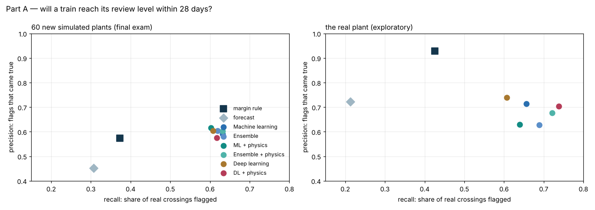
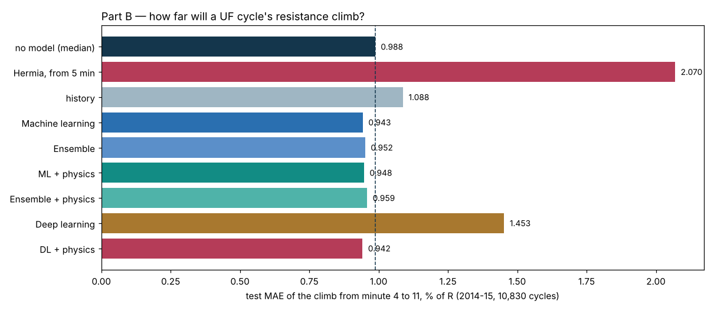
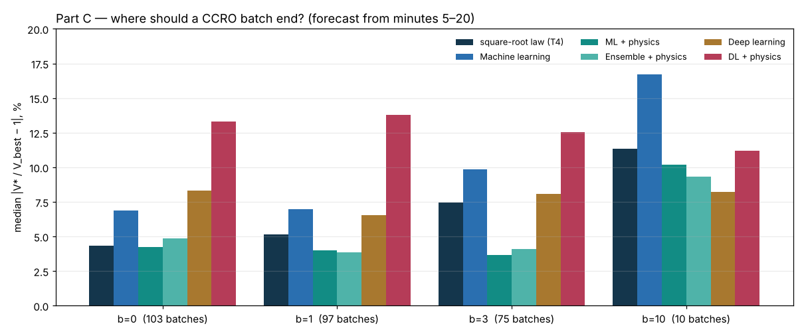

# Project 6 — Does machine learning beat the physics?

**The three questions of Projects 3–5, asked again with the full machine-learning ladder.**

Projects 3–5 answered three questions about time in a desalination plant with physics, statistics
and a decision rule: when will an RO train need cleaning, does fouling follow the tide or the sun,
and when does stopping pay. None of them trained a machine-learning model. This project does — the
same way for each question, declared before each test:

> a physics or no-model baseline → **seven ML models, tuned** → **an ensemble** →
> **ML + physics features** → **deep learning** → **physics-informed deep learning** (a gap-law
> network, a Hermia PINN, a power-law cost network)

Tuning sees development data only, split by group (plant, episode, experiment); each test runs once,
after its declaration is committed (`DECLARED_BEFORE_RUN_A/B/C.md`, commits e7ad90b, c0c9264,
aead79c), by a script that refuses to run otherwise.

---

## ⭐ The headline

| Question | Method to beat | Best result on the test | Verdict |
|---|---|---|---|
| **A** — will an RO train reach its review level within 28 days? | the margin rule | **60 new simulated plants:** every rung catches 0.60–0.63 of the crossings vs the rule's 0.37, at slightly higher precision (0.58–0.62 vs 0.57). **The real plant** (exploratory): the models catch 0.61–0.74 vs 0.43, with more false alarms (precision 0.63–0.74 vs 0.93) | simulation: **ML wins**. Real plant: **a trade, not a win** |
| **B** — from a UF cycle's first 5 minutes, how far will its resistance climb by minute 11? | no model (the median climb) | extra trees: MAE **0.943 vs 0.988** (−4.5 %, interval −8.1 to −0.3 %). Hermia's laws extrapolated from 5 minutes: **2.070** | **a small win for ML**; physics alone loses to doing nothing |
| **C** — from a CCRO batch's first 20 minutes, where should it end? | the square-root law (Project 5's T4) | the **hybrid** — the law's line plus an ML correction: **3.7 % vs 7.5 %** median error at b = 3; ties at b = 0 and 1. Pure ML: **worse than the law** | **the hybrid wins where the law is biased; pure ML cannot extrapolate** |

**One sentence:** machine learning wins when its training data cover the test (simulated plants),
gains a little when the signal is weak (a 12-minute UF cycle), and loses when it must extrapolate
without physics (a batch far longer than any it trained on) — where the hybrid is the one that wins.



---

## What it found

### A. The cleaning question: ML beats the rule on simulated plants, not on the real one

On 60 new simulated plants (21,955 weekly decisions, made after the declaration), at the threshold
frozen on development (the margin rule's development precision), **every model passes the declared
bar**: the frozen random forest catches 0.632 of the crossings against the rule's 0.373 (difference
+0.26, 95 % interval +0.23 to +0.29), at precision 0.591 against 0.574. The physics-informed features
(the gap to the level over the noise, the two Project 3 forecasts) changed nothing that matters
(average precision 0.663 vs 0.660), and neither the networks nor the gap-law network beat the trees.

On the real deposit — 213 decisions in 11 cycles whose answers Project 3 already spent, so no pass
mark — the same frozen models flag more: recall 0.61–0.74 against the rule's 0.43, but precision
0.63–0.74 against its 0.93. **At the rule's recall no frozen pick is as precise (0.66–0.82), and at the
rule's precision they catch at most 0.10 of the crossings.** The simulator is noisier and its cycles longer than
this plant's (Project 3), and the thresholds came from it. Trained on the quieter "matched"
simulator instead (exploratory and optimistic — those settings were chosen after seeing the plant),
XGBoost reaches 0.82 at 0.70.

### B. The UF cycle: the data limit, not the model

Test: the 10,830 cycles of 2014–15 (development: the 4,168 of 2012–13).

| | Test MAE, % of R |
|---|---:|
| No model — the development median climb | 0.988 |
| Hermia's best law, fitted to the first 5 minutes and extrapolated | 2.070 |
| The previous cycle's fouling rate | 1.088 |
| **Extra trees** (the frozen ML pick) | **0.943** |
| Extra trees + physics features · ensembles | 0.948 · 0.952–0.959 |
| HermiaNet (the Hermia PINN) | 0.942 |
| History GRU · MLP | 0.986 · 1.453 |
| Best model of all (RBF SVR + physics features) | 0.914 |

The frozen ML pick passes, narrowly; ensembles, the ML + physics pick and HermiaNet tie with no
model; the MLP and the boosted trees lose — the 2014–15 conditions differ from 2012–13.
**Hermia's four mechanisms cannot be told apart here:** fitted to each test cycle's whole 12-minute
curve, the four laws differ by a median 0.05 % of R at minute 12, against about 1 % of point-to-point
noise — in no cycle does the difference exceed the noise. HermiaNet's mechanism weights are a curve
fit, not a diagnosis. **Hour of day and tide phase added as features made the model slightly worse
(0.956)**: Project 4's "no tide, no daylight effect", from a different method.



### C. The batch end: the hybrid fixes the law's bias; pure ML cannot extrapolate

The development batches mostly stop early (after minute 20 they reach at most 2.3 times the volume
of minute 20); the test batches run to 6.9 times. Every method forecasts the live cost after minute
20 and the same economics picks the end.

| Median \|V*/V_best − 1\| | b = 0 (103) | b = 1 (97) | b = 3 (75) | b = 10 (10) |
|---|---:|---:|---:|---:|
| Square-root law (T4) | 4.3 % | 5.1 % | 7.5 % | 11.3 % |
| Machine learning (ridge) | 6.9 % | 7.0 % | 9.8 % | 16.7 % |
| **Hybrid: the line + extra trees on its departure** | **4.2 %** | **4.0 %** | **3.7 %** | **10.2 %** |
| Hybrid ensemble | 4.9 % | 3.8 % | 4.1 % | 9.3 % |
| MLP | 8.3 % | 6.6 % | 8.1 % | 8.2 % |
| PowerLawNet | 13.3 % | 13.8 % | 12.5 % | 11.2 % |

The law stops short (median V*/V_best 0.96, 0.95, 0.93, 0.89); the hybrid sits on the best
(1.01, 1.00, 0.97). At b = 3 its gain is clear (−3.9 points, interval −4.6 to −2.1); at b = 0 and 1 it
ties, so **the declared bar — better at b = 0, 1 and 3 — is not met.** Some pure-ML models collapse
when asked about volumes they never saw (the SVR: 268 % at b = 1). PowerLawNet fits the curves best
(MAE 0.010 of m20 vs the line's 0.025) and stops worst: an accurate curve is not an accurate decision.



---

## How it works

| | A — RO cleaning | B — UF cycle | C — CCRO batch |
|---|---|---|---|
| Unit | weekly decision × review level | filtration cycle | batch |
| Target | crosses within 28 days (0/1) | climb of ln R, minute 4 → 11 | live cost after minute 20 |
| Development · test | 30 · 60 new simulated plants; real deposit exploratory | 2012–13 · 2014–15 | extremum seeking + open loop · Bayesian optimisation |
| Grouped by | plant | episode | experiment |
| Physics-informed ML | Project 3's forecasts as features | Hermia constants, viscosity, physics predictions | learn only the departure from the law's line |
| Physics-informed DL | **GapLawNet**: predicts a fouling rate; the gap law gives the date | **HermiaNet**: weights four blocking mechanisms; the constant-flux laws give the climb | **PowerLawNet**: predicts how the measured slope decays |

Code: `chemai/models/ladder.py` (the seven models, grouped tuning, thresholds, bootstrap),
`chemai/models/deep.py` (the networks), `chemai/features/ro_decisions.py`,
`chemai/features/uf_forecast.py`, `chemai/features/ccro_forecast.py`.

## Run it

```bash
pip install -e ".[dev,viz,data,ml]"
python projects/p06_ml_ladder/build_ro_dev.py && python projects/p06_ml_ladder/stepA1_ro_dev.py
python projects/p06_ml_ladder/stepA2_ro_test.py         # refuses to run unless DECLARED_BEFORE_RUN_A.md is committed
python projects/p06_ml_ladder/build_uf_curves.py && python projects/p06_ml_ladder/build_uf_rows.py
python projects/p06_ml_ladder/stepB1_uf_dev.py && python projects/p06_ml_ladder/stepB2_uf_test.py
python projects/p06_ml_ladder/build_ccro_rows.py
python projects/p06_ml_ladder/stepC1_ccro_dev.py && python projects/p06_ml_ladder/stepC2_ccro_test.py
python projects/p06_ml_ladder/make_summary.py           # results/summary.json and the figures
```

The UF and CCRO steps need the records Projects 4 and 5 download (`data/`).

## ⚠️ Limits

1. **Part A's real-plant result is exploratory** — its answers were seen in Project 3 — and rests on
   11 cycles: its intervals are wide.
2. **The simulator is not the plant.** Part A's models learned on a noisier simulator with longer
   cycles; their thresholds do not transfer.
3. **Part B predicts 7 minutes ahead** on cycles with about 1 % of noise per minute; the gains are
   small and the climb is not a decision by itself.
4. **Part C's test batches were scored by Project 5's T4**; no model here had seen them, but the
   law's result was known.
5. **Small grids, one seed.** The tuning grids are small on purpose; a wider search could move
   individual models, not the pattern across the three parts.
6. **One record per question**, as in Projects 3–5.

**What this is:** the machine-learning ladder run three times, honestly, on public records.
**What it is not:** a claim that ML does or does not work for desalination — only what these records
let these models learn.
